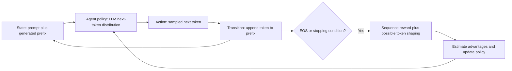

# 01 — Reinforcement learning fundamentals

[Home](README.md) · [Previous: Learning roadmap](00_LEARNING_ROADMAP.md) · [Next: LLM alignment and RLHF](02_LLM_ALIGNMENT_AND_RLHF.md)

## 1. Intuition: learning from consequences

Imagine a robot in a game. It sees a crossroad, chooses left or right, receives feedback, and changes its future decisions. The RLHF PDF uses game playing, a self-driving car and a baby learning to walk as analogies (pages 10 and 15). Their useful shared idea is **interaction → reward → update**. Feedback still comes from a designed environment or a person; “no teacher” does not mean no supervision or no human choices.

The notebook [RL_Fundamental.ipynb](../RL_Fundamental.ipynb) begins with `actions = ["left", "right"]`, a dictionary `Q`, and `get_reward`: right earns +1 and left earns −1. With learning rate `alpha = 0.1`, the update is

$$
Q(a)\leftarrow Q(a)+\alpha[R-Q(a)].
$$

Here Q is an estimate of immediate reward for each action, R is observed feedback, and α determines how much a new observation changes the estimate. Starting from zero, two right observations give 0.1 then 0.19. This is a **stateless bandit-like reward-estimation demo**, not full state-dependent Q-learning: it has no next state, discounted future term, or environment transition. The loop always chooses randomly, so exploration does not become exploitation automatically. The greedy choice in the comments would select `max(Q, key=Q.get)` afterward. Cell 5 repeats one update using the last loop variables, which changes Q again if executed.

## 2. Basic vocabulary

| Term | Game example | LLM example |
|---|---|---|
| Agent | Robot making decisions | Trainable language model |
| Environment | Game rules and transitions | Token-prefix transition plus response scoring system |
| State s | Position and relevant game information | Prompt and all previously generated tokens |
| Action a | Left/right movement | Next generated token |
| Reward R | Points earned by an action or episode | Correctness, preference score, or shaped token reward |
| Reward function | Rule assigning points | Function or model mapping prompt/response to score |
| Policy πθ(a\|s) | Distribution over moves | Softmax next-token distribution; θ are model parameters |
| Episode | One run until game ends | One generation until EOS, length limit, or stopping rule |
| Trajectory τ | States, actions and rewards in order | Generated token sequence and associated prefixes/rewards |
| Terminal state | Goal/death; no further task rewards | End of completed generation |
| Return Gt | Discounted future total points | Discounted shaped rewards remaining in a response |

A **stochastic policy** samples actions with specified probabilities. A **deterministic policy** maps each state to one action. An LLM has a probabilistic policy even when inference chooses a deterministic argmax. Training rollouts generally need sampling diversity.

Use R_t for the reward received after action a_t. For an episode with T actions,

$$
G_t=\sum_{k=0}^{T-1-t}\gamma^kR_{t+k},\quad
J(\theta)=\mathbb E_{\tau\sim\pi_\theta}[G_0].
$$

γ∈[0,1] is the discount factor, t indexes time, and expectation averages over random initial states, transitions and policy actions. With rewards `[0, 0, 10]` and γ=0.9, the initial return is 8.1. γ=1 is common for finite response-level LLM rewards, but it is not universal and does not make infinite-horizon undiscounted sums automatically finite.

## 3. Markov decision processes

An MDP is `(S, A, P, r, d0, γ)`: state space S, action space A, transition probability P(s′|s,a), expected immediate reward r(s,a), initial-state distribution d0(s), and discount γ. Terminal behavior or a finite horizon completes an episodic specification. Reward may more generally depend on `(s,a,s′)`.

The **Markov property** says the current state contains the information needed to predict the next transition and reward; earlier history adds nothing after conditioning on that state. A robot's position alone might fail this if velocity matters. An LLM prefix is a convenient state because autoregressive decisions condition on its whole available context. Tool use and hidden external state can require a richer state or a partially observable formulation.

MDPs separate what the agent controls (policy) from how the world responds (transitions/rewards). This separation lets us derive value recursions and optimize decisions rather than memorize one correct output.

## 4. Value, action value and advantage

$$
V^\pi(s)=\mathbb E_\pi[G_t\mid s_t=s],\quad
Q^\pi(s,a)=\mathbb E_\pi[G_t\mid s_t=s,a_t=a],\quad
A^\pi(s,a)=Q^\pi(s,a)-V^\pi(s).
$$

V averages the future return under the policy from a state. Q fixes the first action, then follows that policy. Advantage measures whether that action is better than the policy's average at the same state. A reward model's completed-response score is different from a critic's prefix-conditioned expected return.

**Source crossroad example:** the RLHF PDF pages 19–20 assigns Q(left)=10, Q(right)=50, Q(straight)=20. Under an illustrative policy `(0.2, 0.5, 0.3)`, V=0.2×10+0.5×50+0.3×20=33. Thus advantages are −23, +17, −13, and their policy-weighted average is zero. These are hypothetical expected returns, not measured scores or probabilities.

### Bellman expectation equations: deriving the recursion

Split the first reward from the return: `G_t = R_t + γG_{t+1}`. Apply conditional expectation and average over the action and next state:

$$
Q^\pi(s,a)=r(s,a)+\gamma\sum_{s'}P(s'\mid s,a)V^\pi(s'),
$$

$$
V^\pi(s)=\sum_a\pi(a\mid s)Q^\pi(s,a)
=\sum_a\pi(a\mid s)\left[r(s,a)+\gamma\sum_{s'}P(s'\mid s,a)V^\pi(s')\right].
$$

The sums become integrals for continuous spaces. Terminal-state V is zero when no rewards remain. If a move earns 2 and reaches a state valued at 5 with γ=0.9, its Q is 6.5.

### Bellman optimality equations

For the best achievable policy, replace the action average with the best action:

$$
V^*(s)=\max_a\left[r(s,a)+\gamma\sum_{s'}P(s'\mid s,a)V^*(s')\right],
$$

$$
Q^*(s,a)=r(s,a)+\gamma\sum_{s'}P(s'\mid s,a)\max_{a'}Q^*(s',a').
$$

The star denotes an optimal value under the stated reward and dynamics, not moral correctness. Maximizing a flawed reward can produce flawed behavior.

## 5. Ways to learn

| Approach | Update idea | Trade-off and relevance |
|---|---|---|
| Monte Carlo | Wait for episode return; move V toward G | No bootstrap; potentially high variance; useful return intuition |
| TD(0) | V(s)←V(s)+α[R+γV(s′)−V(s)] | Bootstraps from an estimate; lower variance but possible bias; PPO critic prerequisite |
| Q-learning | Q(s,a)←Q(s,a)+α[R+γ max_a′Q(s′,a′)−Q(s,a)] | Off-policy optimal-action target; source DQN demo |
| SARSA | Q(s,a)←Q(s,a)+α[R+γQ(s′,a′)−Q(s,a)] | On-policy next sampled action; accounts for current exploratory behavior |
| Value-based | Learn values and derive action selection | Q-learning/DQN; not the supplied LLM preference trainers |
| Policy-based | Directly optimize πθ | Natural fit to pretrained autoregressive LLMs |
| Actor-critic | Actor learns actions; critic estimates return | PPO's common implementation |

**On-policy** updates primarily use trajectories collected by the policy being optimized. PPO uses a frozen recent behavior policy and reuses a rollout for a few epochs; its ratios handle this local mismatch, but arbitrarily old replay is not canonical PPO. **Off-policy** methods can learn from a different behavior distribution. DPO and ORPO are offline pairwise objectives, not ordinary off-policy TD algorithms; GRPO is rollout-based and close to on-policy in its original formulation.

Exploration tries uncertain actions to discover outcomes. Exploitation favors what currently looks best. Epsilon-greedy Q-learning mixes random choices with greedy action selection. LLM temperature and sampling controls affect exploration, but higher temperature can lower answer quality and change rollout probabilities.

## 6. The actual DQN and racing demonstrations

Cells 9–17 of `RL_Fundamental.ipynb` create a network `4→128→2`, its frozen-for-target-computation copy `target_model`, Adam with 1e−3, and MSE loss. Dummy states have shape `[32,4]`, actions `[32]`, network output `[32,2]`. `gather(1, action.unsqueeze(1)).squeeze(1)` selects one predicted action value per row. Under `no_grad`, `target = reward + 0.99 * next_q * (1-done)` produces `[32]` bootstrap targets. Backpropagation updates only the main network.

The dummy random states and rewards do not come from an environment. There is no replay buffer, epsilon-greedy interaction loop, repeated optimization, or target synchronization after initialization. Cell 28 correctly states these omissions. The PDF's grid-world example (pages 25–28) has current Q=4, reward=5, next max=6, γ=0.9: target=10.4, TD error=6.4, squared error=40.96. Calling 10.4 the “correct value” requires qualification: it is correct **relative to this target estimate**, which can change during learning.

Cells 19–27 switch to Stable-Baselines3 PPO with Gymnasium `CarRacing-v3`, `CnnPolicy`, learning rate 0.0003, `n_steps=2048`, batch size 64. `learn(total_timesteps=100)` is a requested minimum budget; **saved output shows 2048 timesteps**, because a full rollout is collected. The stored mean episode reward −58.6 is one historical tiny-run result, not evidence that driving was learned. `render_mode="human"` requires a display; for headless experiments select an appropriate supported rendering mode. Test resets on either termination or truncation, and should close the environment afterward.

LLM tokens are discrete. The PDF's contrast between DQN and continuous steering (page 29) explains a limitation of standard finite-output DQN, but it does not make LLM actions continuous. PPO is convenient because it directly optimizes an existing token policy; DQN-style methods are not mathematically impossible for a finite vocabulary.

## 7. Why policy gradients use log probabilities

A gradient tells us how a small parameter change affects an objective. Write trajectory probability as initial-state probability times transition probabilities times policy probabilities. If transitions and rewards do not depend directly on θ,

$$
\nabla_\theta J
=\mathbb E_\tau\left[G_0\nabla_\theta\log p_\theta(\tau)\right],\quad
\nabla_\theta\log p_\theta(\tau)=\sum_t\nabla_\theta\log\pi_\theta(a_t\mid s_t).
$$

This uses the identity `∇p = p∇log p` (the likelihood-ratio trick). Causality allows replacing the full return by future rewards: past rewards cannot be affected by the current sampled action. A policy-gradient theorem form is

$$
\nabla_\theta J\ \propto\
\mathbb E_{s\sim d^\pi,a\sim\pi_\theta}
[Q^\pi(s,a)\nabla_\theta\log\pi_\theta(a\mid s)].
$$

Here dπ is the discounted state occupancy distribution; the proportionality accounts for its normalization. In an episodic estimator for the discounted start-state objective, one can write `E[Σ_t γ^t G_t ∇logπ(a_t|s_t)]`. Practical finite-horizon undiscounted objectives use γ=1. State clearly which objective and occupancy weighting you use.

Subtracting an action-independent baseline b(s) leaves the expected gradient unchanged because `Σ_a π(a|s)∇logπ(a|s)=∇Σ_aπ(a|s)=0`. Setting b≈V reduces variance and gives an advantage estimate. Baselines and rollout targets are detached in the actor loss. With a positive advantage, maximizing `A logπ` encourages that action; an optimizer minimizing a loss uses `−A logπ`. The PDF's “update proportional to reward times log probability” (page 13) is intuition, not a complete parameter-update equation.

## 8. Importance sampling, entropy and KL

For target distribution p and sampling distribution q with sufficient support,

$$
\mathbb E_{a\sim p}[f(a)]
=\mathbb E_{a\sim q}\left[\frac{p(a)}{q(a)}f(a)\right].
$$

PPO uses current-to-old **action** probability ratios at stored states. This does not exactly correct the entire changed state distribution; it motivates a local surrogate. Large ratios have high variance and motivate clipping.

Entropy of a token policy is

$$
H(\pi(\cdot|s))=-\sum_a\pi(a|s)\log\pi(a|s).
$$

An entropy bonus can encourage diversity; excessive pressure can hurt correctness. For two distributions,

$$
D_{KL}(p\|q)=\sum_a p(a)\log\frac{p(a)}{q(a)}\ge0.
$$

KL is asymmetric, zero for equal distributions, and requires reference support where p has mass. For p=(0.8,0.2), q=(0.5,0.5), KL≈0.193 nats. A sampled log ratio can be negative even though its expectation under p is nonnegative. The old rollout policy and the longer-lived reference policy serve different roles.

## 9. GAE: connect rewards to policy updates

A one-step temporal-difference residual is

$$
\delta_t=R_t+\gamma(1-d_t)V_{\mathrm{old}}(s_{t+1})-V_{\mathrm{old}}(s_t).
$$

$d_t$ is a genuine terminal indicator. $V_{\mathrm{old}}=V_{\phi_{\mathrm{old}}}$ denotes the fixed rollout-time critic estimate, with critic parameters $\phi_{\mathrm{old}}$. Use these same detached estimates in the TD residual and return target; $V_\phi$ later denotes the critic being optimized. Generalized Advantage Estimation mixes short and long bootstrap estimates:

$$
\hat A_t^{GAE}=\sum_{l=0}^{T-1-t}(\gamma\lambda_{GAE})^l\delta_{t+l},
\quad \hat G_t=\hat A_t+V_{old}(s_t).
$$

Continuation factors are also needed across terminal boundaries; above the sum is confined to a single episode. Recursive code uses `A_t = δ_t + γλ(1-d_t)A_{t+1}`. λ near 0 favors short estimates; near 1 favors long returns and generally higher variance. Value error and truncation handling influence bias.

Example: rewards `[0,1]`, values `[0.4,0.5]`, terminal value 0, γ=1 and λ=0.95. Residuals are 0.1 and 0.5; advantages are 0.575 and 0.5. Value targets are 0.975 and 1.0. With λ=1, the first target becomes the Monte Carlo return 1.0. Raw advantage-plus-old-value targets are formed before any optional actor-advantage normalization.

At a time-limit truncation, the underlying task may continue, so value bootstrap can be appropriate. At genuine terminal completion, future task value is zero. Prompt and padding tokens must not accidentally become rollout actions in these sums.

## 10. Map the framework to autoregressive language

For prompt x and response y=(y1,…,yT),

$$
\pi_\theta(y|x)=\prod_{t=1}^T\pi_\theta(y_t|x,y_{<t}),\quad
\log\pi_\theta(y|x)=\sum_{t=1}^T\log\pi_\theta(y_t|x,y_{<t}).
$$

State is `(x,y<t)`, action is yt, and the transition appends that token. A terminal response score can be placed on the final active token; KL or other shaping can supply intermediate rewards. Some systems instead optimize whole-response bandit objectives. Never assume all rewards are token-level or all objectives aggregate identically.

Reusable source: [diagram](diagrams/12_rl_to_llm.mmd).

## Revision and interview takeaway

Reward is immediate feedback; return sums future feedback; V predicts expected return; Q conditions on an action; advantage compares Q with V. PPO learns an actor and commonly a critic; GRPO uses group-derived comparisons; DPO and ORPO learn from offline pairs. The three demonstrations in your RL notebook are a bandit-like update, a dummy DQN training step, and a short library PPO run—not one complete algorithm implementation.

Further reading: [Sutton and Barto, Reinforcement Learning: An Introduction](http://incompleteideas.net/book/the-book-2nd.html); [GAE, Schulman et al., 2015](https://arxiv.org/abs/1506.02438). The GAE paper was retrieved and its advantage-estimation derivation checked; the textbook is a supplementary reading link rather than evidence about your notebook.
