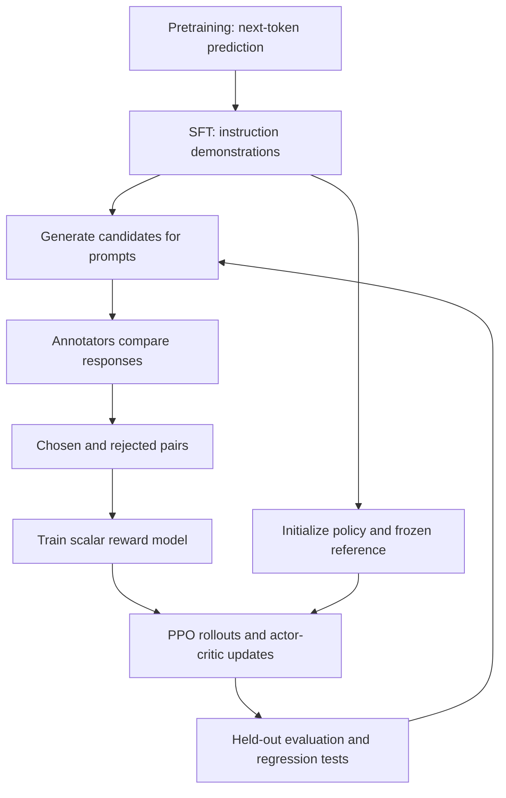
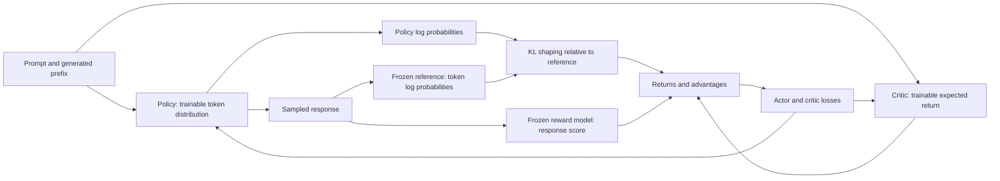

# 02 — LLM alignment and RLHF

[Home](README.md) · [Previous: Reinforcement learning fundamentals](01_REINFORCEMENT_LEARNING_FUNDAMENTALS.md) · [Next: Preference data and reward models](03_PREFERENCE_DATA_AND_REWARD_MODELS.md)

## 1. Why alignment follows language modeling

Pretraining teaches a model to predict text from broad corpora. It can learn syntax, facts and reasoning patterns while also learning unreliable or undesirable behavior. SFT teaches it to respond to instructions by imitating demonstrations. Preferences add information about **which of several plausible responses is better under an annotation rubric**.

The RLHF PDF pages 3–8 uses exam preparation, politeness, and the France/Germany capital example. The DPO PDFs use “explain gravity to a 10-year-old”: both a clear explanation and an unnecessarily technical answer may be fluent, but the user prefers the age-appropriate answer. These examples motivate preference learning beyond one target response. SFT can also learn safety and tone from suitable demonstrations; it is inaccurate to claim it cannot teach human values. Its ordinary likelihood objective simply does not contain an explicit chosen-versus-rejected comparison.

Alignment is a goal and ongoing evaluation process. Optimizing a proxy does not guarantee honesty, harmlessness or every user's values. The PDF statements that alignment “ensures” these properties should be read as intended outcomes, not guarantees.

## 2. What each training stage learns

| Stage | Typical data/objective | What changes |
|---|---|---|
| Pretraining | Next-token likelihood on broad text | General language and representations |
| SFT | Prompt plus demonstrated answer; masked response NLL | Instruction-following behavior |
| Preference collection | Same prompt with ranked candidate responses | Dataset, not necessarily model weights |
| Reward-model training | Pairwise scalar-score comparison | Reward model parameters ψ |
| PPO RLHF | Fresh policy responses and proxy rewards | Policy θ and critic φ |
| Evaluation/iteration | Held-out generations and independent judgments | Decisions about data, rewards and checkpoints |

These are common stages, not a mandatory universal pipeline. ORPO integrates chosen imitation and pairwise preference training in one objective. DPO avoids a separately trained reward model and rollout loop. GRPO uses group-scored rollouts. Synthetic annotation is often called reinforcement learning from AI feedback or preference learning from AI feedback depending on the optimizer; the word “human” does not prove the supplied dataset was human annotated.

Reusable source: [diagram](diagrams/01_classical_rlhf.mmd).

## 3. Four model roles, independent of how many copies are loaded

| Role | Input → output | During reward training | During PPO policy optimization | Can share or reuse components? |
|---|---|---|---|---|
| Policy πθ | Prefix → vocabulary logits/probabilities | Usually not the object optimized by RM loss | Trainable actor | Can be LoRA on frozen backbone |
| Reference πref | Same tokens/prefix → reference logps | Often retained from initial SFT model | Frozen for regularization | Can be adapter-disabled backbone or cached scores for offline pairs |
| Reward rψ | Full prompt and completed response → scalar | Trained from pairwise preference labels | Usually frozen scorer | May use same architecture as policy with scalar head; may instead be a rule function |
| Critic Vφ | Prefix/state → expected remaining return | Not trained by the pairwise RM objective as a critic | Trained to rollout return targets | Can share backbone with actor or be separate; may initialize from RM |

“Four roles” does not imply four independent full-size transformers in every system. Sharing saves memory but couples gradients and requires careful freezing. Offline reference caching removes repeated forward passes only for the exact tokenization and fixed pairs cached.

### Reward model versus critic

The reward model learns **which completed answer is preferred**. The critic estimates **how much shaped future reward the current policy expects from a prefix**. Their objectives and conditioning differ. A reward score 8 for a final answer and critic prediction 6 yield a simple terminal advantage estimate +2 only in a one-step illustration. Real token-level PPO often uses GAE and KL-shaped returns.

In your PPO notebook, `reward_model` and `value_model` both load `./rm_out`. The reward copy is frozen; the value copy trains. Initializing from the same weights does not make them the same role or keep their parameters equal.

### If a role is missing or misconfigured

A policy without trainable parameters cannot learn. A reference that updates accidentally moves the regularization target. An RM scored on answer-only text can miss the prompt's intent. A critic trained to raw RM scores while the actor uses a different shaped return is inconsistent. A separate critic is absent by design in original GRPO, DPO and ORPO; that absence is not a bug in those algorithms.

Reusable source: [diagram](diagrams/02_model_roles.mmd).

## 4. Reward regularization and the proxy problem

A common response-level objective is

$$
\max_\theta\ \mathbb E_{x,y\sim\pi_\theta}[r_\psi(x,y)]
-\kappa\mathbb E_x D_{KL}(\pi_\theta(\cdot|x)\|\pi_{ref}(\cdot|x)).
$$

x is a prompt, y a response, κ≥0 sets the relative penalty, and response KL refers to complete-response distributions. Autoregressive sampled log ratios estimate its decomposition along generated prefixes. The PPO clip ratio instead compares current and **old rollout** policies; those two comparisons must not be confused.

## 5. Challenges and practical mitigations

| Challenge | Mechanism | Useful mitigations and remaining limit |
|---|---|---|
| Reward hacking | Policy finds high-scoring text that is not useful | Adversarial scorer checks, task tests, independent human review; proxies remain imperfect |
| RM overoptimization | Strong optimization exploits scorer blind spots | KL monitoring, early stopping, multiple independent evaluations; KL cannot certify correctness |
| Distribution shift | Generated text differs from RM training comparisons | Add policy-generated hard examples; evaluate by prompt category |
| Inconsistent preferences | Annotators disagree or criteria conflict | Explicit rubric, repeat labels, uncertainty/tie handling; no unique universal preference |
| Instability | Bad scaling, noisy advantage, large update | Conservative learning rate, finite checks, gradient clipping, rollout diagnostics |
| Mode collapse | Many prompts receive repetitive responses | Diversity/entropy/length monitoring and broad evaluations; entropy alone is insufficient |
| Catastrophic forgetting | Specialized optimization harms prior abilities | Regression suite, chosen SFT mixing when appropriate, conservative stopping |
| Length bias | Score rewards verbosity instead of substance | Length-matched annotation, length stratification, reward component audit |
| Reward calibration | Reward scale shifts without stable meaning | Held-out ranking calibration, documented normalization; pairwise scores have additive ambiguity |

A high reward and a good generation are separate observations. Optimizing a reward can help the intended task when the proxy generalizes, but the intended task must be evaluated independently.

## 6. Alternative paths in this repository

**PPO-based RLHF** trains a reward model from pairs and optimizes fresh responses with an actor-critic loop. PPO itself is a general RL optimizer and does not inherently require a learned preference scorer or an SFT reference.

**DPO** trains directly on offline pairs using policy-versus-reference likelihood differences. It has an implicit reward interpretation, not a separately fitted scalar reward network.

**GRPO** samples multiple answers for each prompt and uses relative rewards as advantages. A rule-based reward is a legitimate scorer; a learned RM is also legitimate. The original DeepSeekMath paper includes learned reward models and process supervision, so the later reasoning-notebook rule demo should not be treated as the entire original method.

**ORPO** jointly imitates chosen answers and optimizes chosen/rejected odds without a separate reference. Both ORPO notebook paths begin from an instruction-tuned model; the ability to integrate SFT does not require beginning from raw pretrained weights.

The root README mentions **KTO**, which uses desirable/undesirable judgments rather than necessarily paired comparisons, and the ORPO PDF mentions **SimPO**, a reference-free preference method with its own score/margin objective. Neither has an implemented trainer in these seven notebooks. See [external references](EXTERNAL_REFERENCES.md) for scope and supporting papers.

## Revision

Distinguish training stages, model roles and physical model copies. RM scores responses; critic predicts returns. The classical pipeline is one alignment workflow. Reference regularization, offline pairwise objectives and group-relative rollouts solve different engineering problems and retain different failure modes.
