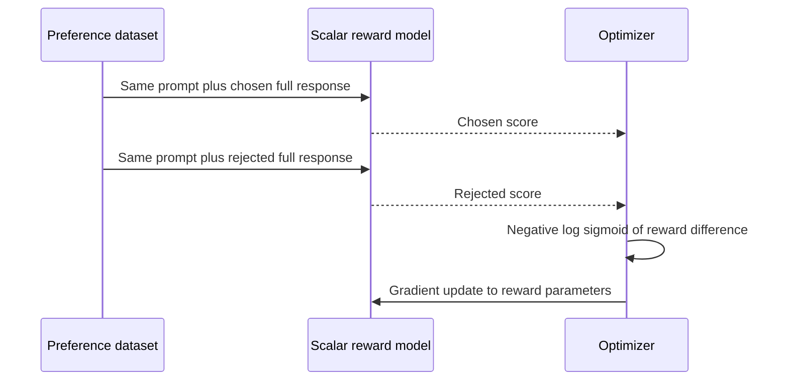

# 03 — Preference data and reward models

[Home](README.md) · [Previous: LLM alignment and RLHF](02_LLM_ALIGNMENT_AND_RLHF.md) · [Next: PPO in depth](04_PPO_IN_DEPTH.md)


## 1. From human judgment to a pair

For one prompt x, annotate a preferred response yw and a less preferred response yl. “Chosen” means preferred **within the presented comparison**, not an absolute correctness certificate. The gravity example in the DPO notes ranks clarity for a child; the local exam example ranks structured advice above panic. Candidate generation and label generation are separate processes: AI-generated answers can still receive human labels, and AI labels can rank human-written answers.

A useful rubric specifies correctness, relevance, tone, safety, completeness and allowed uncertainty. Compare answers under the same prompt and context. Retain annotator disagreement rather than forcing false certainty, and decide explicitly how to represent ties. The provided JSONL has no tie or confidence fields, so those properties cannot be recovered.

Filter malformed pairs, empty answers, contradictory contexts, truncated answers and label mistakes. Deduplicate before splitting. Group paraphrases or related conversations into the same split so a validation answer cannot leak through a nearby training prompt. Use topic/task stratification and separate test prompts that are never used for reward tuning or checkpoint selection.

## 2. A scalar reward model and Bradley–Terry loss

A transformer can represent the full prompt+response and pass its final relevant representation through a scalar head. Let `rψ(x,y)` be the real-valued score, with ψ the trainable reward parameters. Under a Bradley–Terry model at unit preference scale,

$$
P(y_w\succ y_l\mid x)=\sigma(r_\psi(x,y_w)-r_\psi(x,y_l)),\quad
\sigma(z)=\frac1{1+e^{-z}},
$$

$$
\mathcal L_{RM}(\psi)=-\mathbb E_{(x,y_w,y_l)\sim D}
\log\sigma(r_\psi(x,y_w)-r_\psi(x,y_l)).
$$

D is the comparison dataset; `≻` means preferred. A sigmoid converts a score difference into a modeled pairwise probability. This assumes a scalar utility representation and logistic pairwise noise; real preferences can violate these assumptions.

Why this loss? The observed label says the winner wins. Its Bernoulli likelihood is the sigmoid value; negative log-likelihood gives the minimization loss. If chosen score=2 and rejected=−1, difference=3, modeled win probability≈0.9526 and loss≈0.0486. Reversing them gives difference=−3 and loss≈3.0486. This same comparison logic underlies the implicit reward derivation of DPO.

Adding any prompt-only constant c(x) to both rewards leaves the comparison unchanged. The DPO PDFs preserve the useful example `(8,3)` and `(108,103)`: both differences are 5 and induce the same pairwise probability. Absolute score levels cannot be uniquely recovered from pairwise labels alone.



Reusable source: [diagram](diagrams/13_reward_pair.mmd).

## 3. Normalization, calibration and generalization

Pairwise accuracy measures ranking, not whether a score is an absolute quality probability. Check validation pairwise likelihood and reliability of modeled win probabilities on new comparisons. Mean/std normalization can control score scale for RL, but it changes the effective strength relative to KL. Compute normalization statistics on an appropriate fixed training/calibration distribution, document them, and avoid mixing raw and normalized scores in actor/critic targets.

A reward head initialized from a causal LM is usually newly initialized. The PPO notebook's saved load report names `score.weight` as missing; this is expected and requires training. Four preference pairs and one epoch cannot establish broad scorer generalization. Overfitting can manifest as excellent training ranking but poor ranking on policy-generated answers.

## 4. Measured audit of your JSONL

Source: [reward_preferences_dataset.jsonl](../reward_preferences_dataset.jsonl). Full machine-readable report: [dataset_report.json](assets/source_audit/dataset_report.json).

| Check | Measured result |
|---|---:|
| Nonempty records parsed | 20 |
| Invalid JSON lines | 0 |
| Field set per record | Exactly `prompt`, `chosen`, `rejected` |
| Types | All three fields are strings in all records |
| Missing/blank values | 0 / 0 |
| Identical chosen/rejected pairs | 0 |
| Exact duplicate records | 0 |
| Duplicate prompts after lowercase/strip | 0 |
| Chosen longer than rejected in characters | 20 of 20 |

| Field | Character min / max / mean | Whitespace-word min / max / mean |
|---|---|---|
| prompt | 11 / 54 / 33.8 | 3 / 9 / 6.1 |
| chosen | 75 / 131 / 96.75 | 10 / 19 / 14.2 |
| rejected | 32 / 76 / 58.1 | 7 / 13 / 8.8 |

These are Python string lengths and `str.split()` counts, **not tokenizer lengths**. Token counts depend on model tokenizer and formatting and were not measured by loading a model here.

A verified representative record is:

```json
{
  "prompt": "What is AI?",
  "chosen": "AI is the ability of machines to perform tasks that usually require human intelligence.",
  "rejected": "AI is random magic with no real meaning."
}
```

The rows cover study advice, fitness, teaching, productivity, coding, stress and elementary ML concepts. All chosen answers are visibly sensible relative to deliberately weak or false alternatives. This is useful demonstration material but weak evidence for subtle preference learning. No annotator IDs, numeric scores, timestamps, provenance, explicit label field, reference answer or predefined split exists. The schema encodes the preference by column assignment.

All winners are longer in characters. This creates a strong possible length shortcut. The audit establishes the correlation, not that any model actually learned it. Add length-matched hard negatives, correctly scoped responses and topic diversity before serious training. Review medical/fitness advice under a suitable rubric; syntactic cleanliness does not validate every domain claim.

## 5. Actual usage and transformations

The PPO notebook cells 6–7 contain a **commented** local JSONL loader for `/content/reward_preferences_dataset.jsonl`. Active cell 8 uses four inline rows matching the first four records. None of the active DPO/ORPO/GRPO paths directly loads this local JSONL by default.

For the robust DPO notebooks, select `DATA_SOURCE="json"` and set `JSON_PATH` to the actual JSONL filename in a separate run. Hugging Face's JSON loader supports JSONL. The notebook default `preference_data.json` is not the provided filename. The plain-text conversion wraps prompt as user messages and chosen/rejected as assistant completions.

For **ORPO**, the same plain preference schema is structurally suitable after the installed trainer's supported formatting. It does not need a reference answer field or separate reward scores.

For **reward training**, render each full conversation `[user prompt, assistant answer]` for both candidates so the scalar scorer sees x and y. Confirm the installed `RewardTrainer` joins or extracts prompts as intended; answer-only tokenization is not interchangeable with prompt-conditioned scoring.

For **PPO rollout training**, keep prompts and tokenize them with the policy's template; pairwise labels train an RM separately. A frozen trained RM must score new answers. Simply assigning the chosen response's label to every generated answer is invalid.

For **GRPO**, prompts can be reused, but a reliable scorer for newly generated completions is still necessary. You may deliberately transform `chosen` to `reference_answer` for the notebook's similarity demo; this is a new metadata field, not a field originally present. A single chosen answer is not an exhaustive oracle for all valid answers, and text similarity is not mathematical verification.

## 6. Executable loading and validation

This stdlib-only example runs from the source directory, reads the originals, and writes nothing:

```python
from pathlib import Path
import json

path = Path("reward_preferences_dataset.jsonl")
rows = []
required = {"prompt", "chosen", "rejected"}
with path.open(encoding="utf-8") as handle:
    for line_number, line in enumerate(handle, 1):
        if not line.strip():
            raise ValueError(f"Blank line {line_number}")
        row = json.loads(line)
        if not isinstance(row, dict) or set(row) != required:
            raise ValueError(f"Unexpected schema at line {line_number}")
        if not all(isinstance(row[k], str) and row[k].strip() for k in required):
            raise ValueError(f"Invalid string at line {line_number}")
        if row["chosen"].strip() == row["rejected"].strip():
            raise ValueError(f"Identical answers at line {line_number}")
        rows.append(row)
print(len(rows), rows[0])
```

The reusable [validator](assets/validate_dataset.py) also measures lengths and duplicates. It reports defects rather than silently inventing or renaming fields.

## Revision

Good data must have correct context, meaningful labels, hard comparisons and leakage-resistant splits. The local file is clean JSONL with 20 pairs, but its small size and universal winner-length correlation limit conclusions. Reward models learn comparisons; their scores need validation before driving online optimization.
