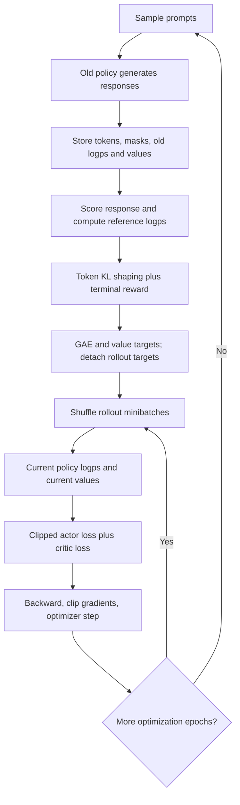
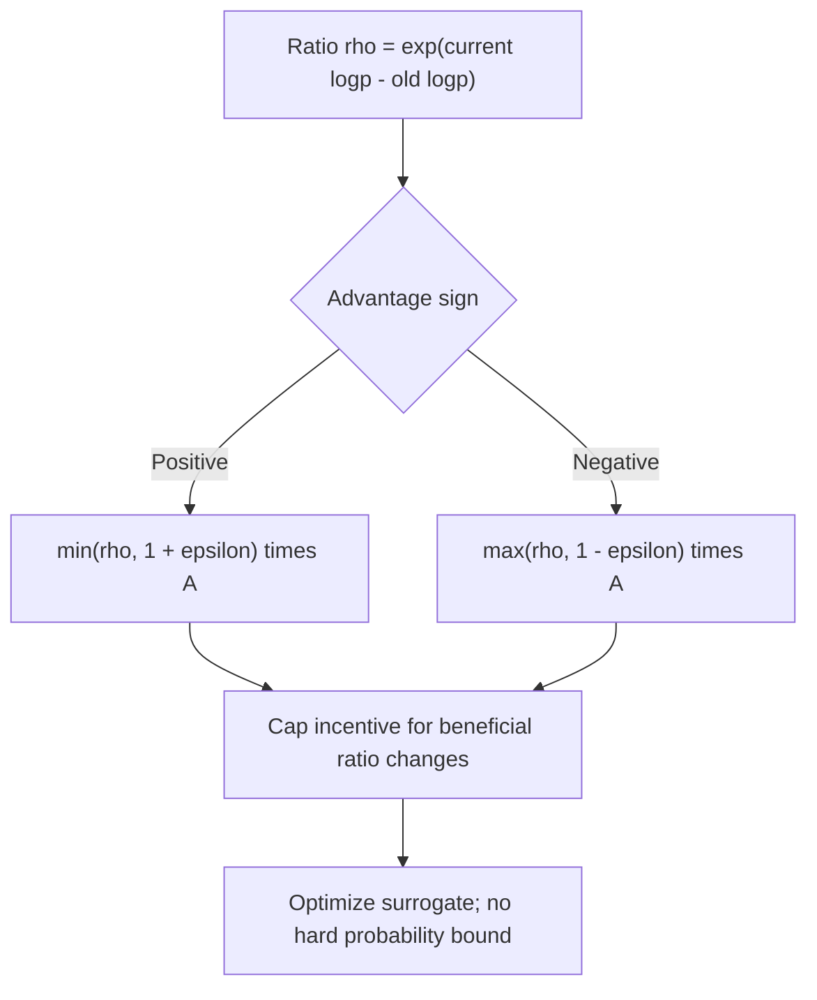
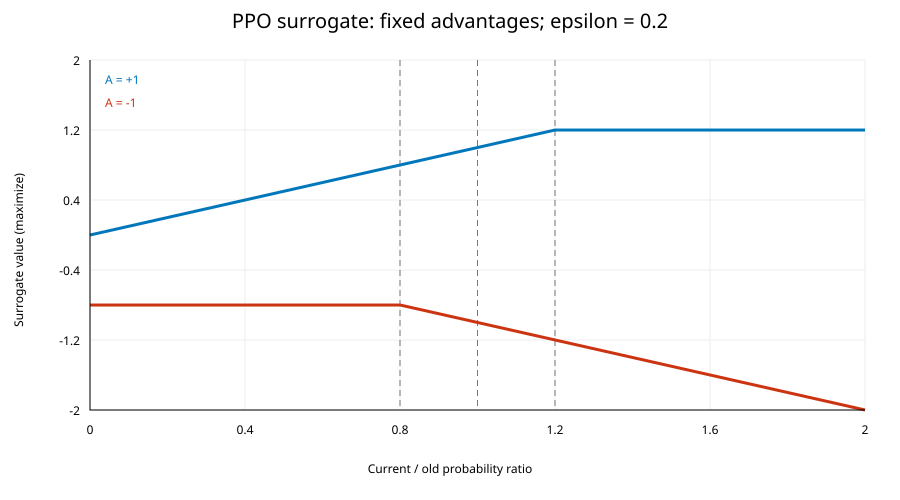

# 04 — PPO in depth

[Home](README.md) · [Previous: Preference data and reward models](03_PREFERENCE_DATA_AND_REWARD_MODELS.md) · [Next: DPO in depth](05_DPO_IN_DEPTH.md)

## 1. Why PPO: improve a policy without rewarding an excessive step

A vanilla policy-gradient update increases the likelihood of actions with positive advantage. If we optimize repeatedly on one rollout, a large parameter change can make that rollout a poor representation of the new policy. PPO uses a local probability-ratio surrogate with clipping to remove further incentive for some overly large beneficial changes.

The RLHF PDF pages 30–36 uses old P(right)=0.60, new P(right)=0.72, reward 5 and value estimate 3. That gives ratio 1.2 and an illustrative advantage +2. This is a one-step pedagogical example; a full response has many token probabilities and usually uses GAE rather than immediate reward minus value.

PPO is a general policy optimizer. In classical LLM RLHF it is useful because it can optimize a nondifferentiable response-level reward model score through sampled token log probabilities, while a critic reduces estimator variance.

## 2. Architecture and rollout data

The actor samples responses from a frozen **old behavior policy** during rollout collection. Store response tokens, active-token masks, old action log probabilities and old critic values. Score complete responses with a frozen RM or other reward source. Score the same actions with the frozen reference. Construct shaped rewards, advantages and return targets before optimizing several minibatches.

A common sampled shaping choice is

$$
k_t=\log\pi_{old}(a_t|s_t)-\log\pi_{ref}(a_t|s_t),\quad
R_t=-\kappa k_t+\mathbb 1[t=T-1]r_\psi(x,y).
$$

κ is the RLHF KL coefficient, T is the number of active response tokens, and rψ is a terminal response score. The expected sampled log ratio under the rollout policy is the corresponding KL. Padding and prompt positions must be excluded. Some implementations use another KL estimator, include EOS penalties, normalize scores, or add an explicit KL loss instead. These are implementation choices, not all confirmed notebook features.

The critic predicts Vφ(st), the remaining shaped return. A final RM score does not directly provide an expected value at every prefix. The critic learns that temporal prediction from rollout targets.

Reusable source: [diagram](diagrams/03_ppo_loop.mmd).

## 3. Derive the ratio surrogate

For stored state/action data from πold, define

$$
\rho_t(\theta)=\frac{\pi_\theta(a_t|s_t)}{\pi_{old}(a_t|s_t)}
=\exp(\ell_{\theta,t}-\ell_{old,t}).
$$

ρ is called r_t in many papers; here ρ avoids confusion with reward. ℓ is the selected token's log probability, θ the current actor parameters, and the denominator is fixed during the optimization of a rollout. At collection, ρ≈1. Recompute the numerator on the exact stored tokens, not on newly generated answers.

Importance sampling motivates the surrogate `E_old[ρ_t Â_t]`. A fixed advantage weights how much increasing an action's relative probability is desirable. This is a local approximation and does not fully correct new-policy state occupancy or guarantee improvement.

## 4. Clipped PPO objective and its sign

The maximized clipped surrogate is

$$
L^{CLIP}(\theta)=\mathbb E_t\left[
\min\left(\rho_t\hat A_t,
\operatorname{clip}(\rho_t,1-\epsilon,1+\epsilon)\hat A_t\right)
\right].
$$

ε>0 determines the ratio interval, usually around 1. Ât is a detached rollout advantage, often normalized for the actor. The minimum chooses the more pessimistic objective. Its effect depends on advantage sign:

$$
\ell_t^{CLIP}=\begin{cases}
\min(\rho_t,1+\epsilon)\hat A_t,&\hat A_t\ge0,\\
\max(\rho_t,1-\epsilon)\hat A_t,&\hat A_t<0.
\end{cases}
$$

For a positive advantage, ratios above the upper limit stop increasing this sample's surrogate. For a negative advantage, ratios below the lower limit stop improving it. Harmful-direction changes remain penalized outside the interval. An optimizer minimizing a loss uses `loss_policy = -mean(clipped_surrogate)`; replacing `min` with `max` without also changing the signs is wrong.

### Worked clipping table

Illustrative ε=0.2; all advantages are fixed during this calculation.

| Advantage | Ratio | Unclipped ρA | Clipped ratio × A | Minimum | Effect |
|---:|---:|---:|---:|---:|---|
| +2 | 1.5 | 3.0 | 2.4 | 2.4 | Stops extra incentive to increase |
| +2 | 0.5 | 1.0 | 1.6 | 1.0 | Still discourages too-low likelihood |
| −2 | 0.5 | −1.0 | −1.6 | −1.6 | Stops extra incentive to decrease |
| −2 | 1.5 | −3.0 | −2.4 | −3.0 | Still penalizes too-high likelihood |

With old probability 0.60 and new 0.95, ρ≈1.583. A positive-advantage sample contributes as if its ratio were 1.2 to the clipped branch. PPO does **not** overwrite the new probability with 0.72. Other samples, shared parameters, critic losses and optimizer momentum can move it further. The source PDF pages 44–45 partly explains this but suggests bounded gradients/updates too strongly: surrogate clipping is not a hard KL or weight-update constraint.

Reusable source: [diagram](diagrams/04_ppo_clipping.mmd).

Plot assumptions: ε=0.2; A=+1 or −1; all states/advantages held fixed. These are analytical curves, not recorded training results. Reproduce with [plot code](assets/plot_objectives.py).

## 5. GAE, critic objective and full training loss

For token reward Rt, genuine termination flag dt, critic Vφ and discount γ,

$$
\delta_t=R_t+\gamma(1-d_t)V_{old}(s_{t+1})-V_{old}(s_t),
\quad \hat A_t=\delta_t+\gamma\lambda_{GAE}(1-d_t)\hat A_{t+1}.
$$

Return targets may be `Ĝt = Ât + Vold(st)` using raw advantages. Some trainers whiten rewards or actor advantages; the critic target must stay in the correct scale. See the two-step numerical example in [Chapter 01](01_REINFORCEMENT_LEARNING_FUNDAMENTALS.md).

A basic critic minimization loss is

$$
\mathcal L_V(\phi)=\frac12\mathbb E_t[(V_\phi(s_t)-\hat G_t)^2].
$$

Some implementations also clip value predictions around old values and take the larger squared error. That is a separate mechanism from policy-ratio clipping. Define it only if the installed trainer actually uses it.

One possible total minimization loss is

$$
\mathcal L_{total}=-L^{CLIP}+c_V\mathcal L_V-c_H\mathbb E_tH(\pi_\theta(\cdot|s_t))
+\kappa_{explicit}\mathbb E_tD_{KL}(\pi_\theta\|\pi_{ref}).
$$

cV weights the critic, cH the entropy bonus, and κexplicit an optional explicit KL term. If KL already shapes rewards, adding a second penalty changes the objective; do not accidentally count it twice. The PPO surrogate is only one part of a practical RLHF implementation. The source notebook does not write these tensors or all coefficients by hand; the trainer implements its own full loss and defaults.

A categorical entropy bonus requires the vocabulary distribution, while a mean sampled negative log probability is an estimator with a different gradient interpretation unless used correctly. Metrics named entropy, KL and non-score reward must be read in the context of the trainer.

## 6. Complete execution-order walkthrough of your PPO notebook

Source: [RLHF_with_PPO_Final_Code.ipynb](../RLHF_with_PPO_Final_Code.ipynb). Cell numbers are **1-based JSON cell order**, including empty/commented cells. Full source and stored outputs are preserved in [cell extract](assets/source_audit/RLHF_with_PPO_Final_Code_cells.md).

| Cells | Actual code and configuration | Theory/data mapping and practical assessment |
|---|---|---|
| 1–2 | Lower-bound installs; imports `RewardTrainer`, `RewardConfig`, and experimental `PPOTrainer`, `PPOConfig` | Recorded output says TRL 1.6.0, CUDA unavailable. APIs are experimental; lower bounds are not a reproducible lock |
| 3 | Seed 42; `dtype=float16` on CUDA else float32; `clear_memory()` | Seeds Python/Torch; CUDA dtype selection does not establish native BF16 support; `empty_cache` cannot free live tensors |
| 4 | Active `model_name="HuggingFaceTB/SmolLM2-135M-Instruct"` | The Qwen model line is commented; policy/RM initialization uses SmolLM2 |
| 5 | `tok_rm`, right padding, EOS fallback | Tokenizer for RM; last relevant token pooling and template consistency matter |
| 6–7 | Commented JSONL loading and transformation | Local file is not loaded during default execution |
| 8 | Four inline `raw_reward_data` rows → `make_chat_prompt` → `make_reward_example` → `reward_ds` | Prompt template with assistant generation prefix; chosen/rejected append EOS. Verify trainer joins prompt and answer; all four match the local file's first records |
| 9 | `rm=AutoModelForSequenceClassification(...,num_labels=1)` | Scalar preference scorer; missing `score.weight` load report reflects new scalar head |
| 10 | `rm_args`: batch 1, epoch 1, LR 1e−5, max length 256, no eval/save strategy | No held-out RM validation. Gradient checkpointing is enabled; trainer fp16/bf16 both false |
| 11–12 | `rm_trainer.train()`, save `./rm_out`; delete RM/trainer/tokenizer | RM stage ends; weights persist on disk. No broad preference-generalization evidence |
| 13 | Policy tokenizer `tok`, left padding | Prompts padded for batched generation; same model vocabulary/template as reward stage |
| 14 | `policy` trainable causal LM; `ref_model` separate causal LM, eval mode and gradients frozen | Actor and fixed KL reference. Old rollout logps are trainer-managed, not `ref_model` |
| 15 | `reward_model` reloads `./rm_out`, eval, all gradients disabled | Frozen scorer of generated responses |
| 16 | `value_model` reloads `./rm_out`, checkpointing enabled, not frozen | Critic initialized from reward weights; same initial architecture, distinct training target |
| 17 | Four `prompt_ds` rows → `tokenize_for_ppo` → `input_ids`, `length`; truncation 128 | Fresh rollout prompts; no chosen/rejected labels in PPO dataset. Filtering length≤128 after truncation cannot detect originally overlong prompts |
| 18 | `ppo_args`: batch 1, accumulation 1, LR 1e−6, 1 minibatch, 1 PPO epoch, 6 episodes, response length 16 | Extremely small smoke demo; discount, GAE λ, KL coefficient, clipping, reward whitening and value clipping are not explicitly set |
| 19–20 | `PPOTrainer(...model=policy, ref_model, reward_model, value_model, train_dataset=...)`; `.train()` | Trainer owns rollouts, logps, values, GAE and losses. No custom PPO loop/tensor calculation appears in notebook |
| 21 | Save policy and tokenizer to `./ppo_out` | Final artifact save; `save_strategy="no"` means no periodic resume checkpoints are configured |
| 22–23 | Load `infer_model`, template prompt, sample 80 tokens; decode entire generated sequence; empty final cell | Inference demonstrates loading, but displayed output includes prompt. Trainer/model objects remain live before reload; cache clearing alone does not release them |

### What the stored outputs establish

The saved execution shows reward training, PPO initialization, policy training and save messages on CPU. A `var()` warning in PPO metrics says degrees of freedom are ≤0 for a singleton ratio-statistic sample. That can explain a diagnostic NaN without proving the optimization loss itself became NaN. The final response discusses exam preparation and includes the full chat prompt. It is not a held-out comparison or a before/after quality test.

### Canonical PPO details delegated to the library

Token-level old/current/reference logps, critic values, KL shaping, GAE, value targets, clipping and minibatch loss are handled by the trainer. Their typical tensor shapes are `[B,T]` for selected token logps/values/rewards, `[B,T]` for active masks, and `[B,T,Vocab]` for full logits where materialized. This describes the architecture, not locally defined notebook variables. Exact masks, defaults, EOS treatment and target normalization require inspection of the installed TRL 1.6.0 implementation. Current upstream PPO paths have moved or disappeared, so live docs cannot verify that historical release's details.

## 7. Practical engineering and improvements

Collect a rollout batch large enough for stable statistics, then use a few optimization epochs and minibatches. The number of fresh prompts/responses, per-device minibatch size and gradient accumulation are related but distinct. Too much reuse makes the rollout stale. On ordinary data-parallel supervised-style updates, effective batch≈microbatch×accumulation×world size; PPO also has a rollout budget and minibatch partitioning that must be checked in its config.

For the source demo, first validate RM inputs and evaluate its rankings on genuinely held-out pairs. Use fresh prompts rather than only the four reward-training prompts. Log raw score, KL-shaped reward, response length, value loss, clip fraction and actor ratio statistics. Specify coefficients explicitly after verifying their names in the installed API.

Set mixed precision based on actual support; FP16 weights with both training precision flags disabled are not the same as FP32 training. Use appropriate loss scaling for FP16 where supported. Clip gradient norm separately from PPO probability-ratio clipping. Gradient checkpointing trades recomputation for activation memory; disable training cache as appropriate and re-enable it for generation if supported.

Save full trainer state (optimizer, scheduler, RNG and step), not just final model weights, when resume is required. The notebook has a final save but no explicit resume example. Keep independent evaluation and stop before proxy overoptimization. Release all live model/trainer references before loading another full model when memory is tight. Decode `generated_ids[0, input_length:]` for answer-only inference.

## 8. Common mistakes

Confusing reference with old policy breaks ratio meaning. Treating reward minus value as exact token advantage ignores future shaped rewards. Forgetting completion masks trains on prompt/padding actions. Recomputing old probabilities after an update invalidates the fixed denominator. Differentiating through returns or old values changes the estimator. Claiming clipping guarantees stability overstates its protection. A learned RM is required by this RLHF notebook, but not by general PPO with environment/rule rewards.

## Revision

PPO collects recent-policy trajectories, calculates detached advantages and targets, then updates actor and critic with a clipped surrogate and value loss. Its old policy supports local rollout reuse; the RLHF reference anchors behavior. Your notebook is a six-episode trainer-based demonstration with a four-pair reward model, not a validated alignment run.

Primary reference: [Schulman et al., Proximal Policy Optimization Algorithms, 2017](https://arxiv.org/abs/1707.06347); [GAE](https://arxiv.org/abs/1506.02438). See [reference verification notes](EXTERNAL_REFERENCES.md) for historical PPO API limits.
