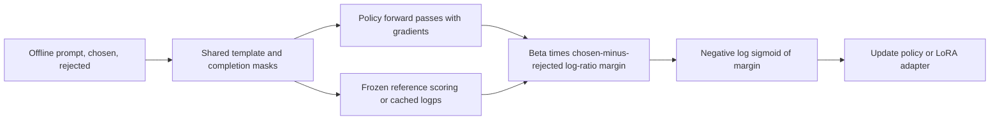
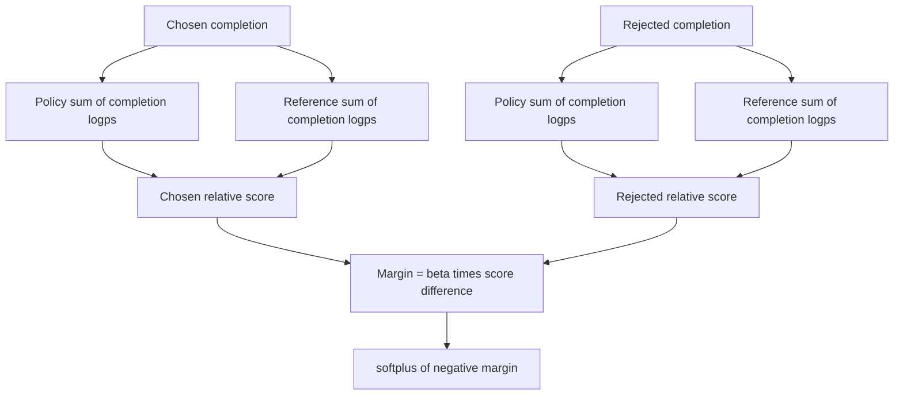
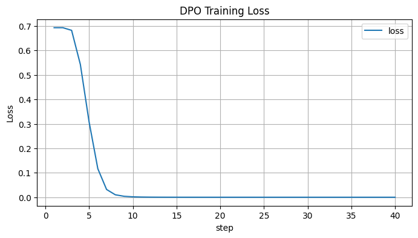

# 05 — DPO in depth

[Home](README.md) · [Previous: PPO in depth](04_PPO_IN_DEPTH.md) · [Next: GRPO in depth](06_GRPO_IN_DEPTH.md)

## 1. Motivation: move the preference comparison into the policy objective

Classical PPO RLHF fits a scalar reward model, generates responses, estimates advantages with a critic and optimizes a policy. DPO asks whether we can fit the preference relation directly through policy probabilities. It uses a mathematical correspondence between rewards and optimal KL-regularized policies, eliminating an explicit reward model and online rollout loop.

The DPO PDFs' useful teaching progression is: chosen relative score, rejected relative score, their difference, sigmoid, negative logarithm. Their gravity, fever and simple-AI examples emphasize comparative preference. Preserve that intuition, but do not interpret DPO as guaranteed monotonic growth of each chosen answer's absolute likelihood. The supplied saved outputs give a concrete counterexample.

## 2. Derive the reward–policy relationship

Fix one prompt x and reward function r(x,y). Consider the response-level optimization

$$
\max_\pi\sum_y\pi(y|x)r(x,y)
-\beta\sum_y\pi(y|x)\log\frac{\pi(y|x)}{\pi_{ref}(y|x)},
\quad \sum_y\pi(y|x)=1.
$$

β>0 is the KL penalty coefficient in this formulation. The reference must have support for responses to which the policy assigns positive mass; normalization must be finite. This is a distribution-level derivation, not proof that finite neural-network training reaches the optimum.

Introduce multiplier η(x) for normalization. Differentiate with respect to π(y|x):

$$
r(x,y)-\beta\left[\log\frac{\pi(y|x)}{\pi_{ref}(y|x)}+1\right]+\eta(x)=0.
$$

Solve and normalize:

$$
\pi^*(y|x)=\frac{\pi_{ref}(y|x)e^{r(x,y)/\beta}}{Z(x)},\quad
Z(x)=\sum_y\pi_{ref}(y|x)e^{r(x,y)/\beta}.
$$

Z is the partition function ensuring probabilities sum to one. Higher reward tilts the reference toward that response. At a fixed reward, larger β makes the tilt weaker, so the optimum stays nearer the reference.

Rearrange:

$$
r(x,y)=\beta\log\frac{\pi^*(y|x)}{\pi_{ref}(y|x)}+\beta\log Z(x).
$$

This is the reward reparameterization. A policy-induced implicit reward can be written `r̂θ(x,y)=β log[πθ(y|x)/πref(y|x)]` after choosing a prompt-dependent reward offset. It is not just an unlogged probability ratio. Scores differing by c(x) induce the same pairwise preferences.

### Cancel the difficult partition function

Under Bradley–Terry, `P(yw ≻ yl | x)=σ(r(x,yw)−r(x,yl))`. Substitute the reward reparameterization: βlogZ(x) cancels because both responses have the **same prompt**. Thus we can fit preferences without estimating Z or training a separate scalar network.

The assumptions are a scalar reward model of preferences, logistic comparison likelihood, a fixed supported reference, and an expressive enough policy class. DPO does not establish that every human preference is representable by one consistent scalar utility.

## 3. Standard DPO loss, term by term

$$
\mathcal L_{DPO}(\theta)=-\mathbb E_{(x,y_w,y_l)\sim D}
\log\sigma\left(\beta\left[
\log\frac{\pi_\theta(y_w|x)}{\pi_{ref}(y_w|x)}
-\log\frac{\pi_\theta(y_l|x)}{\pi_{ref}(y_l|x)}\right]\right).
$$

x is the prompt; yw is the winner; yl the loser; πθ the trainable model; πref a fixed reference; β the scaling inherited from the KL derivation; σ the logistic sigmoid; D the pairwise dataset.

Define completion sequence log probabilities `ℓθ,w`, `ℓref,w`, `ℓθ,l`, `ℓref,l`. The margin is

$$
z=\beta[(\ell_{\theta,w}-\ell_{ref,w})-(\ell_{\theta,l}-\ell_{ref,l})],
\quad \mathcal L=-\log\sigma(z)=\operatorname{softplus}(-z).
$$

The subtraction compares how much the policy has promoted the winner **relative to the reference**, against its promotion of the loser. A large positive margin makes loss small. Use stable `logsigmoid` or `softplus`; do not exponentiate long sequence likelihoods and divide tiny probabilities.

### Worked examples preserved from the sources

If the already β-scaled chosen/rejected scores are 2 and −1, z=3, σ(z)≈0.9526, loss≈0.0486. Reverse them to −2 and +1: z=−3 and loss≈3.0486. DPO final PDF page 14 calls 95.26% “confidence”; this is a model comparison probability under the assumed link function, not validated real-world confidence.

An explicit log-probability example: `ℓθ,w=−4`, `ℓref,w=−5`, `ℓθ,l=−6`, `ℓref,l=−5`, β=0.1. Winner score=0.1, loser score=−0.1, z=0.2, loss≈0.5981. The loss can improve even if both answers lose absolute probability as long as the rejected likelihood falls more relative to the reference.

At initialization with policy=reference, both implicit rewards are zero, z=0 and loss=log2≈0.6931. A strict `winner_reward > loser_reward` accuracy metric counts equal scores as false, explaining the source's initial 0.0 preference accuracy rather than implying the original model knows no good answers.

Reusable source: [diagram](diagrams/05_dpo_pipeline.mmd).

Reusable source: [diagram](diagrams/06_dpo_logps.mmd).

This common scalar curve also describes RM and ORPO losses when their respective margins are substituted. It is illustrative; [plot code](assets/plot_objectives.py) reproduces it.

## 4. Gradient and beta: two related interpretations

For fixed reference logps,

$$
\nabla_\theta\mathcal L
=-\beta\sigma(-z)\left[
\nabla_\theta\log\pi_\theta(y_w|x)-\nabla_\theta\log\pi_\theta(y_l|x)
\right].
$$

The factor σ(−z) gives more weight to misranked/hard comparisons. The loss encourages winner-over-loser relative likelihood through shared parameters; it does not independently control every sequence probability. Easy comparisons can saturate.

At fixed reward in the optimal-policy derivation, larger β means stronger KL regularization. At fixed observed log-ratio margin during neural training, increasing β also steepens the logistic scaling and can change saturation/gradient magnitude. Dataset, learning rate, epochs, reference choice and loss variants affect the actual outcome. Therefore “larger beta always makes stronger preference learning” or “always produces a closer policy” is too simple. `beta=0.1` in your notebooks is a demo configuration, not a universal optimum.

## 5. Tokens, masks and reference behavior

Standard causal DPO uses the **sum** of log probabilities of completion tokens:

$$
\ell_\theta(x,y)=\sum_t m_t\log\pi_\theta(y_t|x,y_{<t}),
$$

where mt=1 only for included completion tokens (including EOS if the chosen convention includes it). Prompt/padding positions have zero loss mask. A mean log probability changes the sequence scoring and standard objective unless a specific length-normalized variant is intended.

Shift logits by one token: logits at position j predict input token j+1. Input attention masks exclude padding from attention; completion loss masks exclude prompt tokens from scoring. They solve different problems. Labels `−100` are a training ignore sentinel and must never be passed directly as a gather index. Correct padded position IDs and causal attention remain necessary, especially for left padding.

Apply the model's chat template exactly once. Choose whether data already contains complete conversations or separate prompt/completion messages. The chosen and rejected histories must agree. Adding BOS/EOS again after a template already supplied them can shift the boundary. Tokenization of `prompt + answer` need not equal concatenation of independently tokenized prompt and answer due to boundary token merges; inspect the full tokenized sequence and trainer's boundary logic.

A separate frozen model is one reference implementation. With LoRA over an untouched frozen base, disabling the newly trained adapter can supply the initial reference distribution. If the desired reference already includes an SFT adapter, disabling all adapters would instead revert to the wrong base unless a frozen reference adapter or equivalent mechanism is retained. Cached reference logps must match exact formatted pairs, masks and truncation. `ref_model=None` is not synonymous with “no reference policy.”

## 6. All three notebooks compared using actual code

| Item | DPO_Training.ipynb | DPO_Training_Final.ipynb | Final_DPO.ipynb |
|---|---|---|---|
| Source cells | 47 | 47; identical source to preceding notebook | 15; compact prototype |
| Model | Qwen2.5-0.5B-Instruct | Same | Same |
| Active data | Four inline ML examples | Same | Full `trl-lib/ultrafeedback_binarized`, no subset |
| Local JSON option | `DATA_SOURCE="json"`; default filename differs from local JSONL | Same | Loader and path commented |
| Eval | Seeded split; 3 train / 1 eval for inline demo | Same | None |
| LoRA | r=16, α=32, all-linear, dropout .05 | Same | r=8, α=16, q/v/k/o projections |
| 4-bit | NF4, double quantization, conditional CUDA loading | Same | bitsandbytes installed; no quantization config used |
| Batch/accumulation | 1 / 8 | Same | 2 / 4 |
| Optimization | LR 5e−5, β .1, 40 inline steps; otherwise 1 epoch | Same | LR 1e−5, β .1, 3 epochs |
| Precision code | CUDA/support checks; CPU float32 | Same | BF16 whenever CUDA, FP16 whenever CPU: unsafe flags |
| Reload | `AutoPeftModelForCausalLM` | Same | `AutoModelForCausalLM`; version-dependent adapter autodetection |
| Saved execution | 40-step outputs and metrics | Same main metrics despite different saved version strings | KeyboardInterrupt in cell 12; no verified completed save/inference |

Do not infer improvements simply from “Final” in a filename. The 47-cell pipelines are the better documented starting point. Their source is identical, so consolidate the walkthrough and preserve output provenance differences.

### Execution order for both 47-cell notebooks

| Cells | Objects/data produced | Why they matter and what to inspect |
|---|---|---|
| 1–5 | Intro, correction list, unpinned `%pip install -U` | The claimed prior bugs correspond to the compact prototype; installs need a tested lock |
| 6–7 | Imports, `SEED=42`, Python/NumPy/Transformers seeds and printed versions | Reproducibility within an environment; saved outputs are not a requirements file |
| 8–11 | `MODEL_NAME`, `DATA_SOURCE`, `JSON_PATH`, hardware flags and `COMPUTE_DTYPE` | Selects dataset and precision; saved T4 BF16 output needs native/emulated-support verification |
| 12–13 | `INLINE_DATA`, `convert_plain_text_to_conversational`, `dataset` | Four ML concepts; plain strings become user/assistant message lists. Optional JSON checks field names but not all row values |
| 14–15 | `train_dataset`, `eval_dataset` | Seeded held-out split, only one eval example in active demo |
| 16–19 | `tokenizer`, left padding; `quantization_config` | Template/IDs plus conditional 4-bit NF4/double-quant compute configuration |
| 20–21 | `peft_config` | r16/α32 all-linear LoRA; base parameters frozen by PEFT |
| 22–23 | `model_init_kwargs`, `training_args` | `dtype`, SDPA, max length512, sigmoid loss, checkpointing, cosine schedule, eval10/save20, two checkpoints retained |
| 24–25 | `trainer=DPOTrainer(model=MODEL_NAME, ref_model=None, ...)` | Reference behavior is library/PEFT-managed; trainer owns chosen/rejected tokenization and loss. Quantization keyword acceptance is version-dependent |
| 26–31 | `initial_metrics`, `train_result`, `final_metrics` | Baseline loss, training and after-loss evaluation; no independent pretraining text-generation baseline |
| 32–33 | `history` DataFrame and loss plot | Mixed event rows can contain missing columns; displayed NaNs alone do not prove numerical failure |
| 34–37 | Saved adapter/tokenizer; delete trainer, collect garbage | Trainer save includes adapters with periodic checkpoints; verify full-state checkpoint before resume |
| 38–39 | `model=AutoPeftModelForCausalLM`, saved tokenizer | Correct explicit PEFT reload; optional quantized inference kwargs |
| 40–43 | `generate_response`, `test_prompts` | Applies template, stores input length, decodes new tokens only. Tests mostly repeat training concepts |
| 44–47 | Local ZIP creation, real-training warnings, official links | Colab convenience and limitations; not alignment validation |

Exact cell source/outputs: [DPO_Training](assets/source_audit/DPO_Training_cells.md), [DPO_Training_Final](assets/source_audit/DPO_Training_Final_cells.md).

### Compact prototype execution order

[Final_DPO.ipynb](../Final_DPO.ipynb) cell 1 displays a four-row literal but does not assign it to `dataset`. Cells 2–4 install/import and set Qwen/output constants. Cell 5's local loader is commented. Cell 6 assigns the downloaded UltraFeedback training split; the displayed literal is unused. Cells 7–9 load tokenizer/model and LoRA. Cell 10 sets the three-epoch config and incorrect precision flags. Cell 11 constructs `DPOTrainer`. Saved output warns about tokenized prompt versus prompt+rejected prefix mismatch, so boundary formatting requires inspection. Cell 12 is interrupted. Cells 13–14 define save and inference but have no saved execution outputs proving they ran. Cell 15 is empty.

The inference fallback catches every template exception and silently switches to a raw prompt; this can conceal a meaningful format mismatch. Modern Transformers may auto-detect PEFT adapters, so plain `AutoModelForCausalLM` loading is not universally broken; explicit PEFT loading makes intent/version requirements clearer. Prototype decoding includes the prompt. `device_map="auto"` is primarily an inference dispatch convenience and needs care for distributed training.

## 7. Interpret the saved evaluation correctly

Both detailed notebooks store initial eval loss 0.693147 and final 0.182760 on **one held-out pair**, with training loss≈0.077171 over 40 steps. Chosen logp changes from −51.2026 to −58.4874; rejected from −53.9604 to −77.3133. With β=.1, chosen implicit reward≈−0.7285 and rejected≈−2.3353; margin≈1.6068. The model lowered both absolute sequence probabilities while improving their relative preference margin.

That is a direct code-grounded correction to “chosen probability always increases.” One-pair preference accuracy 1.0 is not a broad alignment result. The stored loss curves are nearly identical, so they are not independent evidence of version robustness. The before/after metrics match exactly despite saved versions differing; reproducibility/provenance is unverified.

Historical output limitations: one generation's overfitting analogy is awkward, and another claims regression models use linear relationships; nonlinear regression is valid. Preference loss improvements do not establish factual accuracy. The T4 output says BF16 supported; T4 lacks native BF16 tensor-core support, so inspect device capability and the installed PyTorch support-check semantics, including emulation, before adopting that setting.

## 8. Recommended implementation approach and pitfalls

Use the 47-cell pipeline's schema validation, split, optional quantization, PEFT saving/reloading and completion-only generation as the starting pattern. Connect the actual JSONL intentionally, strengthen value/type checks, build a larger prompt-separated evaluation set and pin a tested environment. Inspect trainer-created completion masks on one batch before training. Specify intended loss/reference behavior explicitly and test adapter-disabled reference scores before updates.

DPO can overfit noisy/easy pairs, suppress both candidate likelihoods, exploit length shortcuts, and drift outside the data distribution. Monitor held-out relative rewards, both absolute logps, lengths, independent task quality and regressions. Reference conditioning motivates regularization but is not a hard bound on model drift. Memory depends on reference sharing/caching, pair sequence lengths, optimizer states and LoRA—not just the number of named model roles.

## Revision

DPO substitutes a policy/reference log ratio for a latent reward and fits pairwise logistic preferences. Z cancels within a prompt. Standard DPO uses a fixed reference and completion-summed logps. Your best source pipeline delegates the loss to TRL; its 40-step four-example run proves a demonstration can produce artifacts, not general alignment.

Primary reference: [Rafailov et al., Direct Preference Optimization: Your Language Model is Secretly a Reward Model, 2023](https://arxiv.org/abs/2305.18290); [official TRL DPO documentation](https://huggingface.co/docs/trl/dpo_trainer). The PDF's approximately 61% versus 57% TL;DR comparison is supported by the original paper under its specified evaluator/baseline setting; it is not a result from these notebooks or a universal ranking.
