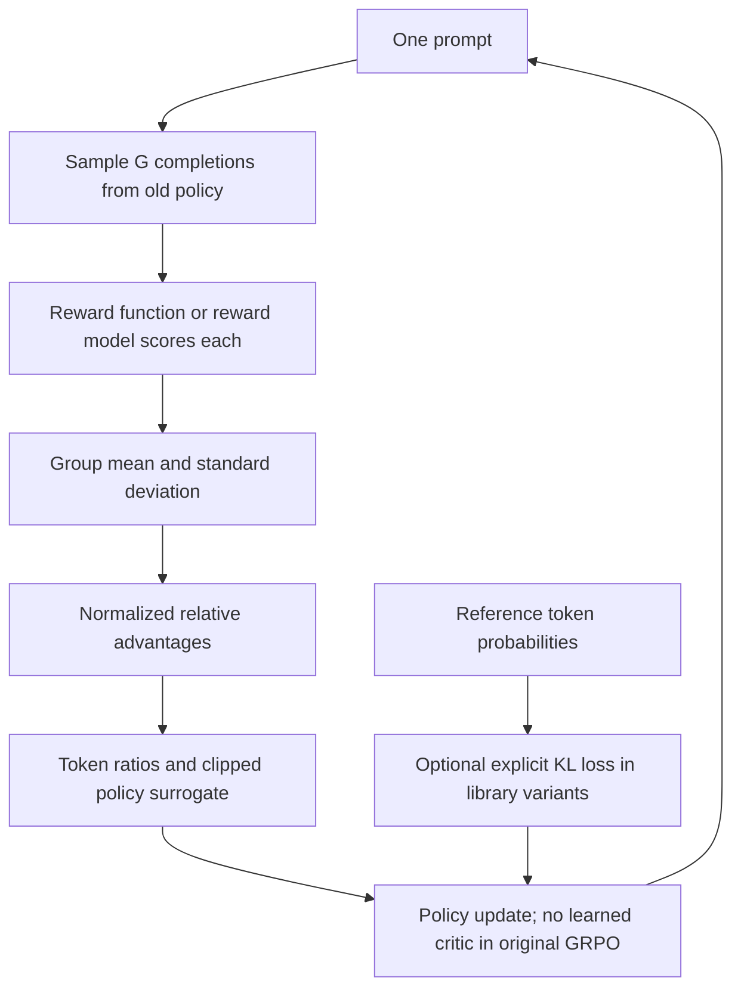

# 06 — GRPO in depth

[Home](README.md) · [Previous: DPO in depth](05_DPO_IN_DEPTH.md) · [Next: ORPO in depth](07_ORPO_IN_DEPTH.md)

## 1. Why group-relative learning

A large critic can be expensive and hard to train from sparse end-of-response rewards. The original DeepSeekMath formulation replaces that learned value baseline with comparisons among answers to the same prompt. GRPO samples a group, scores it, and reinforces answers that outperform their group.

The GRPO PDF pages 2–3 traces DeepSeek-Coder-Base-v1.5 7B → continued mathematical pretraining → math SFT → DeepSeekMath-RL. The paper confirms 120B math-related tokens as a major part of a larger continued-training mixture and introduces GRPO in 2024. Do not replace the coder checkpoint with the distinct DeepSeek-LLM family. The PDF's later family timeline contains claims beyond the original paper; these are source-context items with unverified release details, not prerequisites or evidence for the algorithm.

The motivating sentence “GRPO is PPO without a critic” captures one important difference but omits group sampling, normalization, token/sequence weighting and explicit KL placement. Later implementations may change all of those.

## 2. Workflow and group example

For each prompt x, sample G responses `yi ~ πold(·|x)`. An outcome scorer produces Ri for each answer. Compute their mean and standard deviation, then normalize each score into a relative advantage.

The PDF's `2+2` example (page 4) samples `[4,5,4,6]` with rewards `[1,0,1,0]`. Mean μ=0.5; using population std, s=0.5. Centered rewards are `[+.5,−.5,+.5,−.5]`; normalized advantages are `[+1,−1,+1,−1]` (before any numerical epsilon). The handwritten `reward−mean` values are a useful introductory baseline but omit the std division in original outcome GRPO.

The page-8 example rewards `[9,6,2]` has mean 17/3≈5.667; centered values `[3.333,.333,−3.667]`; population std≈2.867; normalized advantages≈`[1.162,.116,−1.279]`. These are pedagogical scores, not DeepSeek or notebook measurements.

Reusable source: [diagram](diagrams/07_grpo_groups.mmd).

## 3. Original outcome-supervision mathematics

$$
\mu_x=\frac1G\sum_{i=1}^G R_i,\quad
s_x=\sqrt{\frac1G\sum_i(R_i-\mu_x)^2},\quad
\hat A_{i,t}=\frac{R_i-\mu_x}{s_x+\varepsilon_{norm}}.
$$

G is responses per prompt, i indexes responses, t indexes completion tokens, and εnorm is a numerical stabilizer added in practical code. Original outcome normalization is described using group std; whether code uses population std, sample std, a stabilizer or threshold must be checked. The same sequence advantage is broadcast to included tokens in outcome supervision.

For response yi of length Ti,

$$
\rho_{i,t}=\frac{\pi_\theta(y_{i,t}|x,y_{i,<t})}{\pi_{old}(y_{i,t}|x,y_{i,<t})},
$$

$$
J_{GRPO}=\mathbb E_{x,\{y_i\}\sim\pi_{old}}\left[
\frac1G\sum_i\frac1{T_i}\sum_{t=1}^{T_i}
\left\{\min(\rho_{i,t}\hat A_{i,t},
\operatorname{clip}(\rho_{i,t},1-\epsilon,1+\epsilon)\hat A_{i,t})
-\kappa_{GRPO}\hat K_{i,t}\right\}\right].
$$

This shows original response-mean then group-mean weighting; completion masks replace the valid-token sum in padded batches. θ is current policy, πold collected the group, ε is PPO-style clip width, κGRPO is the KL coefficient. A minimization implementation uses `−J`. This is distinct from DPO's β inside a preference sigmoid.

One positive pointwise KL estimator used in the original paper is

$$
q_{i,t}=\frac{\pi_{ref}(y_{i,t}|s_{i,t})}{\pi_\theta(y_{i,t}|s_{i,t})},
\quad \hat K_{i,t}=q_{i,t}-\log q_{i,t}-1\ge0.
$$

For actions sampled from πθ, its expectation equals `DKL(πθ||πref)` when both distributions have compatible support and are normalized. Samples actually come from πold, so reused old-policy data raises sampling/gradient approximation questions; some libraries apply bias corrections or alternative estimators. Nonnegative samples do not remove these distinctions. The original GRPO KL term is added explicitly to the objective rather than included inside reward normalization, unlike common PPO RLHF shaping.

### Process supervision in the original paper

DeepSeekMath also explores scores at the end of reasoning steps. Normalized process rewards contribute to token advantages through sums of subsequent step rewards. The sequence-level broadcast formula above is **outcome supervision**, not the sole original GRPO variant. A separately learned critic is absent, but reward baselines and advantage computation remain value-related computations.

### Later library variants

Token-mean aggregation over the entire batch differs from averaging each response first: longer responses carry different weight. DAPO-style and fixed-denominator variants change length/normalization behavior. `scale_rewards="group"`, batch normalization, no std scaling, token/sequence importance ratios, asymmetric clipping and iteration counts are separate configuration choices. A zero KL coefficient may avoid needing reference forward passes; original GRPO includes a reference penalty.

The saved TRL **1.7.0** signature in notebook cell 31 lists `loss_type="dapo"`, `scale_rewards="group"`, `num_iterations=1`, ε=.2 and β default 0.0. The source cell 29 sets β=.01 but does **not** set `loss_type`. Therefore its recorded library path defaults to a DAPO aggregation variant, not necessarily the exact original response-mean GRPO objective. This is stronger evidence than assuming a `GRPOTrainer` name proves paper fidelity.

## 4. Equal rewards, variance and diversity

If `[1,1,1,1]` are all correct, μ=1, std=0 and centered advantages are zero. With a numerical stabilizer, the preference-gradient contribution is zero; without one, division yields NaN. KL or other losses can still update parameters. The same problem occurs for all-wrong groups. Log the fraction of constant-reward groups and whether the scorer sees the right answer metadata.

Increasing G increases chances of useful within-prompt differences, but requires more generation tokens and memory. Temperature too low yields duplicate responses; too high yields mostly junk and unstable reward comparisons. Reward normalization can overweight a tiny reward gap in an otherwise homogeneous group; changing std scaling changes the learning objective. Choose meaningful tasks, appropriate difficulty and reward resolution rather than adding arbitrary noise to labels.

For mathematical correctness, exact answer checks or tests can provide reliable signals when parsing and tolerances are designed carefully. Open-ended answers often need a learned or judge-based scorer. Format rewards certify format, not reasoning validity. A reward model is optional; a reward signal remains essential, as the handwritten pages 9–11 emphasize.

## 5. The first notebook path: eight-prompt similarity demonstration

Source: [Final_GRPO_Practical.ipynb](../Final_GRPO_Practical.ipynb). Full [cell extract](assets/source_audit/Final_GRPO_Practical_cells.md) preserves Markdown, comments and stored outputs.

| Cells | Actual data flow and configuration | Implication |
|---|---|---|
| 1–4 | Unpinned installs; removes torchao for reported conflict; imports regex/SequenceMatcher/Dataset/TRL/PEFT | Environment workaround is specific to recorded setup, not a requirement of GRPO |
| 5–11 | Eight `prompt` and `reference_answer` rows; `format_prompt` creates `Question: ...\nAnswer in simple English:` | Reference metadata survives `.map`; gold text is for reward functions, not teacher-forced SFT |
| 12–15 | `HuggingFaceTB/SmolLM-135M-Instruct` (not SmolLM2); tokenizer left padding; FP16 on CUDA; LoRA r8/α16 q/v | Text prompt format is custom plain text; training and inference use it consistently |
| 16–18 | Markdown reward-source/model-role comparisons | Correctly allows rules or learned reward; “PPO RM present” applies to RLHF pattern, not all PPO |
| 19–23 | `normalize_text`, `get_completion_text`, `similarity_score`, `keyword_overlap_score` | Character sequence similarity and set-based keyword recall; neither proves semantic correctness |
| 24 | `correctness_reward`: `2.5*sim + 2.5*overlap`, returns 0 if `reference_answer` missing | Range 0–5 when inputs valid; missing metadata silently erases this reward |
| 25 | `helpfulness_reward`: length bands, punctuation bonus, bad-phrase penalty | Rewards superficial style; “not sure” can be honest, so automatic penalty is potentially harmful |
| 26 | `clarity_reward`: alphabetic content, length band, repeated-character penalty | Readability heuristic; English alphabet check is not multilingual quality |
| 27–30 | `GRPOConfig`, trainer with three reward functions and `remove_unused_columns=False` | Extra metadata must reach scorer. Equal reward weighting is library-managed; no custom advantage/loss tensors in notebook |
| 31–32 | Prints TRL signature then trains | Recorded TRL1.7.0 and DAPO default; saved 10-step TrainOutput exists |
| 33–36 | Save adapter/tokenizer, reload with `PeftModel`; generate via same custom prompt | Saved response includes prompt because whole sequence is decoded; no held-out evaluation loop |

Cell 29 config: LR1e−5, per-device batch4, accumulation1, `num_generations=4`, completion length80, temperature.9, top_p.95, β=.01, max_steps10, checkpoint every10, checkpointing false, fp16 on CUDA. Group batch constraints concern the effective generation batch across devices/steps in the installed version. “Per-device batch must always be divisible by G” is too broad.

The comment in cell 23 says keyword overlap example is 3/5=.6 for `Machine learning learns from data`; the regex includes words of at least three letters and set sizes, which indeed yields five words for that reference. SequenceMatcher operates on normalized **characters**, not semantic embeddings or necessarily word-level sequences. The heuristic reward may favor copying gold text, punctuation and length while missing factual errors.

Saved output: 10 optimizer steps, training loss≈.063335, reported epoch1.25, and an AI definition. That loss is not comparable numerically to DPO/ORPO losses and does not measure held-out correctness. Generation reaches an incomplete final item; truncation and length should be inspected.

## 6. The second path: GSM8K reasoning with Unsloth and vLLM

| Cells | Actual implementation | Checks and limitations |
|---|---|---|
| 37–40 | New Unsloth/vLLM installs; Qwen2.5-0.5B-Instruct, max sequence1024, 4-bit, fast inference, LoRA rank16; all attention/MLP projections | Distinct workflow; dependency compatibility is unpinned. VRAM utilization .6 is vLLM planning, not a memory guarantee |
| 41 | `SYSTEM_PROMPT`, XML reasoning/answer format | Teaches an output format; valid XML-like tags do not certify reasoning |
| 42 | `get_gsm8k_questions`: loads `openai/gsm8k`, parses text after `####`, builds system/user message prompt and `answer` metadata | Full train split, no demo subset or eval split in source; missing delimiter returns None |
| 43–44 | `extract_xml_answer`, exact-string `correctness_reward_func`: 2 for gold match else0 | Equivalent numeric answers like `12.0` vs `12` can lose reward; malformed tags need stricter parser |
| 45 | `int_reward_func`: .5 for `.isdigit()` | Negative/decimal values fail; output type is not answer correctness |
| 46–48 | Soft/strict regex rewards .5 each; `count_xml` fractional tag/trailing-text rewards | Formatting can accumulate substantial reward for incorrect numeric answers; trailing-text expressions should be checked on boundary cases |
| 49–51 | LR5e−6, Adam betas .9/.99, decay.1, cosine/warmup.1, paged8bit optimizer; per-device batch1, accumulation1, G4; prompt256/completion768, max_steps100, grad norm.1 | Conflicts with earlier single-device grouping setting for versions requiring effective generation batch divisible by G; verify or configure generation batch/steps, do not assume runnable |
| 52–54 | Save LoRA, `fast_generate` apple-count test, merged16bit save | Source present; no stored outputs from this second path establish training or export success |

The second config omits explicit β, loss type, std convention and generation batch settings. The first path's TRL version output cannot prove versions after its new installation cells. No group sampling, mean/std calculation, ratio tensor or custom clipped objective is handwritten in either path; `GRPOTrainer` owns them. The reference can be an adapter-disabled base when supported, but exact behavior must be verified in the selected version.

## 7. Recommended use and debugging

Use the first path to learn the reward-function interface, then replace text similarity with a task-appropriate scorer before drawing quality conclusions. For reasoning, start with a small GSM8K subset, a robust gold-answer parser and a supported effective grouping config. Keep a disjoint test set. Test reward functions on correct, wrong, equivalent, empty and malformed completions before training. Log each reward component, group std, zero-variance fraction, completion lengths, format success, exact correctness and KL separately.

The absence of a critic can save parameter/optimizer memory, but G responses and long reasoning sequences can dominate generation cost. Beware unvalidated `device_map="auto"` in distributed training, scorer metadata columns dropped by preprocessing, format reward overwhelming correctness, truncated answers and all-identical samples.

## Revision

Original GRPO estimates a baseline and normalized advantage from a same-prompt group, uses a clipped token-ratio objective and explicit reference KL, and avoids a learned critic. Your notebook has one stored 10-step heuristic run plus an unexecuted-output GSM8K path; its recorded default loss aggregation is DAPO-style. Reward design and grouping are central, not incidental details.

Primary reference: [Shao et al., DeepSeekMath: Pushing the Limits of Mathematical Reasoning in Open Language Models, 2024, §4.1](https://arxiv.org/abs/2402.03300); [official TRL GRPO documentation](https://huggingface.co/docs/trl/grpo_trainer). The paper's 51.7% MATH result belongs to its model and evaluation setting, not your small-model notebook.
