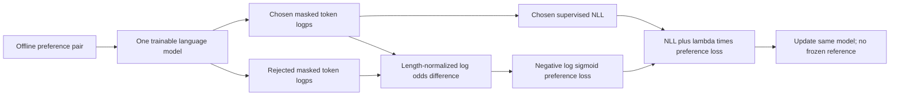

# 07 — ORPO in depth

[Home](README.md) · [Previous: GRPO in depth](06_GRPO_IN_DEPTH.md) · [Next: Algorithm comparison and selection](08_ALGORITHM_COMPARISON.md)


## 1. Intuition: imitate the chosen answer and discourage the rejected one

SFT maximizes the likelihood of demonstrated answers. Shared language patterns can also raise unwanted answers' likelihood. ORPO combines chosen-answer negative log-likelihood with an odds-based chosen/rejected comparison in one training objective. It removes the separate frozen reference distribution used in standard DPO.

The ORPO PDF pages 3–8 describes this as monolithic, single-stage instruction plus preference learning. It can start from a pretrained model, but your two notebook paths actually load `Qwen/Qwen2-0.5B-Instruct`. Single-stage optimization does not mean no earlier pretraining/SFT occurred in that checkpoint.

ORPO uses offline preference pairs, without PPO rollouts, a learned critic or a separate RM. Reference-free design changes the objective; it is not standard DPO with a model copy deleted.

## 2. Define sequence likelihood carefully

Let y contain T response tokens and mt be its completion mask. The true autoregressive sequence log probability is

$$
\ell_\theta(x,y)=\sum_{t=1}^{T}\log\pi_\theta(y_t|x,y_{<t}).
$$

A sum-based SFT sequence NLL is `−ℓθ(x,yw)=−logπθ(yw|x)`. Practical trainers generally average the chosen-token NLL over included tokens to control loss scale.

The ORPO paper defines the score used in its odds through **length-normalized likelihood**:

$$
\bar\ell_\theta(x,y)=\frac{\sum_t m_t\log\pi_\theta(y_t|x,y_{<t})}{\sum_t m_t},
\quad p_\theta(x,y)=e^{\bar\ell_\theta(x,y)}.
$$

p is the geometric mean of completion token probabilities. It lies in (0,1], but scores over different responses do **not** form a normalized distribution over those responses. Calling p the calibrated chance that an entire answer occurs is incorrect. In this chapter π denotes true sequence likelihood, while p denotes ORPO's normalized likelihood score. This distinction is missing from the source PDF's elementary 0.75/0.25 example and matters in implementation.

## 3. Probability, odds, log odds and odds ratio

For a probability-like score p∈(0,1),

$$
\operatorname{odds}(p)=\frac{p}{1-p},\quad
\operatorname{logodds}(p)=\log p-\log(1-p).
$$

Odds compares an event's probability with its complement. Applying this transform to ORPO's normalized likelihood scores gives an odds-based preference surrogate; it does not magically calibrate the scores.

For chosen score pw and rejected pl,

$$
OR_\theta(x,y_w,y_l)=\frac{p_w/(1-p_w)}{p_l/(1-p_l)},
\quad \Delta_{OR}=\log OR
=(\bar\ell_w-\bar\ell_l)-[\log(1-e^{\bar\ell_w})-\log(1-e^{\bar\ell_l})].
$$

Do not substitute `ℓw−ℓl` alone for log odds; that is a log probability ratio and changes the objective. For small p, odds approaches p, but that is an approximation, not equality.

The preference minimization loss is

$$
\mathcal L_{OR}=-\mathbb E_D\log\sigma(\Delta_{OR}),\quad
\mathcal L_{ORPO}=\mathcal L_{SFT}+\lambda_{OR}\mathcal L_{OR}.
$$

λOR≥0 balances the chosen imitation and preference loss. The paper often uses λ; your TRL configs call this `beta=.1`. That β is a coefficient multiplying the ORPO preference component, not DPO's KL-derived beta or GRPO's KL penalty coefficient.

### Derivation of the comparison objective

If OR is the odds-based preference strength, `σ(logOR)=OR/(1+OR)`. Positive log odds means the winner has higher odds; the sigmoid maps that difference to a bounded preference score. For an observed winner, negative log of that score gives the logistic comparison loss. This is ORPO's designed surrogate, not a Bradley–Terry fit of a separately trained reward network.

The derivative `d logodds(p)/d log p = 1/(1-p)` shows how the odds transform changes gradient weighting. As p approaches 1, numerical conditioning becomes difficult; computing raw probabilities in low precision can round them to exactly 1. Stable log-space computation and finite checks matter.

## 4. Reproduce the source's worked example

ORPO PDF pages 11–16 uses prompt `2+2`, chosen `4`, rejected `5`, illustrative scores pw=.75 and pl=.25.

| Quantity | Calculation | Value |
|---|---|---:|
| Chosen SFT NLL in the one-token illustration | −ln(.75) | .287682 |
| Chosen odds | .75/.25 | 3 |
| Rejected odds | .25/.75 | 1/3 |
| Odds ratio | 3/(1/3) | 9 |
| Log odds ratio | ln9 | 2.197225 |
| Sigmoid preference score | 9/(1+9) | .9 |
| Preference loss | −ln(.9) | .105361 |
| Total with λOR=.1 | .287682+.1×.105361 | .298218 |

The PDF rounds intermediate values to .288 and .105, giving approximately .2985; using unrounded values gives .298218. This is rounding clarification, not a different algorithm. The .75/.25 values are chosen for a simple demonstration; real normalized sequence scores need not sum to 1.

Reverse pw and pl: odds ratio=1/9, Δ≈−2.197225, sigmoid=.1, preference loss≈2.302585. Chosen SFT loss=−ln(.25)≈1.386294; total at λ=.1≈1.616553. Both components penalize the reversed ranking in this example.



Reusable source: [diagram](diagrams/08_orpo_objective.mmd).

## 5. Stable executable mathematical snippet

This PyTorch example operates on already computed completion-mean logps and a chosen-token NLL. It implements the objective components, not an entire trainer:

```python
import math
import torch
import torch.nn.functional as F

def log1mexp(log_p):
    # log(1-exp(log_p)); input must be strictly negative.
    if not torch.all(log_p < 0):
        raise ValueError("Require log p < 0; inspect empty masks and rounding")
    log_p = log_p.float()
    far = log_p < -math.log(2)
    result = torch.empty_like(log_p)
    result[far] = torch.log1p(-torch.exp(log_p[far]))
    result[~far] = torch.log(-torch.expm1(log_p[~far]))
    return result

chosen_mean_logps = torch.tensor([math.log(.75)], requires_grad=True)
rejected_mean_logps = torch.tensor([math.log(.25)], requires_grad=True)
log_odds_difference = (
    chosen_mean_logps - log1mexp(chosen_mean_logps)
    - rejected_mean_logps + log1mexp(rejected_mean_logps)
)
preference_loss = -F.logsigmoid(log_odds_difference).mean()
chosen_token_nll = -chosen_mean_logps.mean()  # One-token illustrative batch
loss = chosen_token_nll + .1 * preference_loss
assert torch.isfinite(loss)
loss.backward()
print(loss.item())
```

Use FP32 for sensitive log-odds arithmetic where appropriate. Branch indexing above avoids evaluating a numerically singular inactive branch, which can otherwise contaminate gradients in a `torch.where` implementation near p=1. Empty completion masks must be rejected before division. Silent clamping can hide a formatting bug; if used for robust numerics, document its effect. Trainer token-average SFT across a batch can differ from mean-of-sequence NLL when lengths vary.

Current fetched TRL ORPO source calls `get_batch_logps(...average_log_prob=True)`, computes `log_odds` in FP32, returns `beta*logsigmoid(log_odds)` as a **negative-valued reward-like term**, and subtracts it from NLL in the final loss. That sign convention equals NLL plus beta times positive preference loss. A helper returning negative values does not imply the loss sign is wrong. Upstream source docstrings still mention reference logps in one helper despite ORPO being reference-free; read the actual code.

## 6. Actual standard-TRL notebook path

Source: [Final_ORPO_Practical.ipynb](../Final_ORPO_Practical.ipynb). Full [cell extract](assets/source_audit/Final_ORPO_Practical_cells.md) retains both paths and errors.

| Cells | Actual code/configuration | Explanation and issues |
|---|---|---|
| 1 | Deletes `trainer`, `model`, calls gc/Torch cache functions before local imports | Depends on previous runtime state; clean execution can NameError. Saved output instead shows an asynchronous CUDA assert, so it cannot establish a clean run |
| 2–5 | Uninstall then upgrade torchao≥.16; install `trl==1.9.2` with other unpinned packages; experimental ORPO imports | Different strategy from GRPO's torchao removal; environment-specific, not algorithmic. Saved optional binary-load warnings |
| 6–7 | Qwen2-0.5B-Instruct, UltraFeedback, output path; supported CUDA/BF16/FP16 branching | Qwen2 differs from DPO's Qwen2.5. Saved output says CUDA/BF16 true; actual GPU capability not printed here |
| 8–9 | Fast tokenizer right padding, EOS fallback; causal model compute dtype, cache disabled, pad ID set | Attention masks/ignored labels must match padding; trainer owns data tokenization |
| 10–12 | Load/shuffle seed42, subset100; cell11 older config commented; cell12 repeats subset100 | Saved external dataset columns are chosen/rejected/score_chosen/score_rejected, not the local JSONL schema. Implicit conversational prompts can be extracted by supported trainers |
| 13 | ORPOConfig: LR8e−6, beta.1, epoch1, batch1/accum4, max length512, checkpointing, log10, save epoch | β weights preference component. No eval dataset or eval strategy set; reproducibility limited by unpinned surrounding libs |
| 14–15 | LoRA r8/α16 q/k/v/o, dropout.05; create trainer and `.train()` | No separate reference/RM/critic object. Loss internals are delegated to ORPOTrainer |
| 16–17 | Save adapter/tokenizer, `trained_model=trainer.model`, enable cache, template prompt and completion-only decode | Using trainer model retains active adapter. Saved inference raises CUDA assert, so successful generated response is not established |

Cell 15 stored `TrainOutput` says global_step25, training loss≈3.204586, epoch1.0. This matches 100 examples with effective pair batch4 on one device. It is an output artifact with no held-out preference or task comparison. The trainer warns that it set `remove_unused_columns=False`; make that explicit when using that version. Neither the total loss nor warnings prove why inference failed.

After a CUDA device-side assert, restart the process/runtime to clear the poisoned context. Check token IDs against embedding size, generation EOS/PAD IDs, labels, special-token vocabulary changes and version compatibility. Use synchronous CUDA launches in a separate diagnostic run if needed. The cleanup-cell traceback may report an earlier asynchronous error; “empty_cache caused it” is not a justified diagnosis.

## 7. Actual Unsloth path and versions

| Cells | Implementation | Assessment |
|---|---|---|
| 18–20 | Fresh-runtime instruction; install Unsloth and pinned Transformers4.56.2, TRL.22.2, Datasets4.3.0; import `PatchDPOTrainer` | Distinct environment from experimental TRL1.9.2; do not install both paths in one live interpreter |
| 21–23 | Qwen2-0.5B-Instruct, sequence512, 4-bit; Unsloth LoRA r8/α16, all attention+MLP projections, dropout0, seed42, optimized checkpointing | QLoRA path reduces base memory; dropout0 is chosen for optimized implementation, not mandatory ORPO math |
| 24–25 | Shuffle/subset500; `format_preference_example` extracts chosen prompt history and final chosen/rejected assistant content, adds EOS | Check rejected history equals chosen history and both last roles are assistant. Existing function checks only length≥2, not those invariants |
| 26–28 | `PatchDPOTrainer()`; ORPO imports from top-level TRL; config LR8e−6, β.1, epoch1, batch1/accum4, prompt/completion256, 8bit Adam, warmup.1; `tokenizer=...` | Keyword and patch compatibility require verification in pinned environment. Pinned version does not make all unpinned dependencies reproducible |
| 29–32 | Train, save adapters, Unsloth inference with new-token slicing, merged16bit export | No stored outputs from this path establish completion or export success |
| 33 | Fully commented consolidated Unsloth alternative | Duplicate source teaching material; does not execute |

Here source versions are installation **requests**, not proof of installed successful runs. Experimental `processing_class` and older `tokenizer` interfaces must not be mixed. The notebook does not implement custom odds loss functions or calculate its own loss tensors; the equations above explain the trainer's intended behavior and fetched upstream implementation, with historical-version boundaries marked.

## 8. Trade-offs and corrections

ORPO removes reference forward passes, which can reduce memory/compute compared with otherwise similar DPO loading a separate reference. DPO reference caching/sharing, fused operations and different sequence lengths can narrow or reverse practical comparisons. “ORPO always needs less memory” is too broad.

A large preference coefficient can damage chosen imitation or encourage shortcuts; a small one approaches SFT. Monitor chosen NLL and preference component separately, plus held-out quality. Length-normalization changes bias but does not eliminate all length bias. No reference KL anchor means regression tests and stopping criteria become especially important.

The PDF page 9 calls DPO universally “safest” and ranks industry adoption. Those are unverified broad claims and do not justify a technical selection rule. Paper validation up to 7B (PDF page17) describes the original study, not a hard algorithm size limit. Later model examples and external deployment claims are retained as source-context leads in the audit rather than treated as benchmark evidence here.

## Revision

ORPO uses one trainable policy, chosen SFT NLL, and an odds-ratio comparison of length-normalized completion likelihoods. Probability ratio, odds ratio and log odds are distinct. Your notebook contains a stored 100-example TRL run with inference failure plus a separate unverified-output 500-example Unsloth path.

Primary reference: [Hong, Lee and Thorne, ORPO: Monolithic Preference Optimization without Reference Model, 2024](https://arxiv.org/abs/2403.07691); [EMNLP paper record](https://aclanthology.org/2024.emnlp-main.626/); [official TRL ORPO docs](https://huggingface.co/docs/trl/orpo_trainer).
