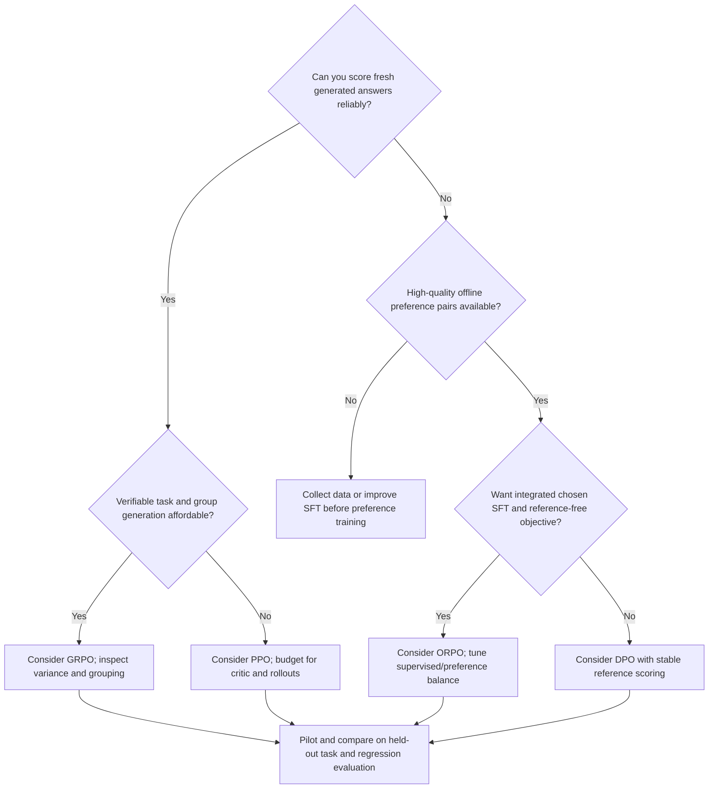

# 08 — Algorithm comparison and selection

[Home](README.md) · [Previous: ORPO in depth](07_ORPO_IN_DEPTH.md) · [Next: Practical implementation guide](09_PRACTICAL_IMPLEMENTATION_GUIDE.md)

## 1. Compare objectives and required information first

Choose the optimizer from the supervision available and the engineering budget. Offline pairs support direct preference objectives; fresh-answer scoring supports rollout methods. More components do not automatically mean better alignment, and fewer components do not remove data/reward problems.

| Dimension | PPO (classical LLM RLHF use) | Standard DPO | Original outcome GRPO | Standard ORPO |
|---|---|---|---|---|
| Core idea | Actor-critic optimization with clipped local updates | Fit preference likelihood via policy/reference ratios | Group-relative advantages for sampled answers | Chosen imitation plus odds preference penalty |
| Main objective | Clipped advantage surrogate plus critic and optional entropy; RLHF KL shaping/penalty | −logσ of β-scaled difference of policy/reference log ratios | Group/response average clipped token surrogate minus explicit KL | Chosen-token NLL + λ×negative log sigmoid of log odds ratio |
| Policy-stage dataset | Prompts; rewards from scored fresh responses | Same-prompt chosen/rejected pairs | Prompts with scorer metadata if required | Same-prompt chosen/rejected pairs |
| Pairwise labels | Needed to train preference RM in classical pipeline; not by PPO itself | Required in standard pairwise objective | Not required if rewards are available; learned RM may use pairs | Required |
| Reward model | Typical classical RLHF scorer; rules/environment also valid | No separate RM | Optional reward source; original paper uses learned models too | No separate RM |
| Reference | Typical RLHF KL anchor; not intrinsic to general PPO | Standard formulation requires distribution/scoring | Original formulation includes reference KL | Not required |
| Critic | Learned return predictor in common PPO | None | No separate learned critic in original | None |
| Online/offline | Fresh rollouts, local reuse | Offline fixed pairs | Fresh groups, local reuse | Offline fixed pairs |
| Samples during optimization | Policy-generated responses | No online response generation needed | Multiple policy-generated responses | No online response generation needed |
| Responses per prompt | Often one per rollout prompt; can be more | Two supplied candidates, not generated online | G>1 for meaningful group comparison | Two supplied candidates, not generated online |
| Cost drivers | Rollouts, scorer/ref forwards, actor+critic backward | Pair policy forwards/backward and ref scoring/caching | G×generation tokens, rewards, policy/ref forwards | Pair policy forwards/backward plus chosen NLL |
| Memory drivers | Policy optimizer+critic, scorer/ref weights, rollout tensors/cache | Trainable policy/adapter, pair activations, reference or cached scores | Policy/adapter, grouped KV caches, reference if used | Policy/adapter and pair activations |
| Implementation complexity | High: masks, rollout semantics, return targets, multiple roles | Moderate: formatting, likelihoods and reference | High: sampling/grouping/rewards and variants | Moderate: formatting and numerically stable odds |
| Tuning/stability | Sensitive to score scale, learning rate, value quality and KL | Usually simpler loop; β/data/epochs still matter | Sensitive to reward variance, grouping/diversity, normalization and KL | Sensitive to NLL/preference balance and score normalization |
| Common uses | Optimize flexible feedback on newly generated outputs | Offline helpfulness/style/safety preference tuning | Reasoning, coding, tasks with scalable answer rewards | Joint instruction/preference optimization with no reference |
| Strengths | Flexible rewards and fresh-policy exploration | Simple offline supervised-style optimization | Critic-free comparative baseline, flexible reward sources | Single-stage objective and no ref scoring |
| Limitations | Scorer/critic reliability and expensive rollout machinery | Offline coverage limits; relative likelihood can improve while both scores fall | Generation overhead; equal-reward groups lose signal | No KL reference anchor; coefficient and odds conditioning matter |
| Failure modes | Reward exploitation, value error, large KL, stale rollouts | Mask/template mismatch, noisy labels, length shortcuts, regression | Zero variance, format gaming, incorrect parsing, length weighting | Odds numerical failure, preference domination, masking/format errors |

The “typical PPO” column is the RLHF notebook's pattern, not a universal requirement for PPO in a game. The GRPO column is original outcome GRPO, not every modern trainer default. Memory rankings depend on model sizes, precision, sharing, caching, response length and rollout settings.

## 2. Model roles separate from model copies

| Role | PPO RLHF | DPO | GRPO original | ORPO |
|---|---|---|---|---|
| Trainable policy | Yes | Yes | Yes | Yes |
| Frozen reference policy | Typical KL anchor | Yes, possibly shared/cached | Yes for original KL; optional in some β=0 variants | No |
| Separately trained RM | Common, but another reward source can replace it | No | Optional source; no removal of reward requirement | No |
| Learned value/critic | Common actor-critic PPO | No | No in original group-baseline formulation | No |

Reference predicts baseline probabilities; RM predicts preference scores; critic predicts future return. A frozen backbone with adapter disabled can implement a reference under the right initialization conditions. It is still a reference distribution.

## 3. Decision guide with realistic examples

Reusable source: [diagram](diagrams/10_selection_tree.mmd).

**Only offline pairs and a capable instruction model:** DPO is a reasonable baseline. Use the detailed DPO notebook's split, formatting and PEFT workflow. With the local 20 examples, limit claims to a smoke demonstration and collect harder data before choosing a deployment checkpoint.

**Offline pairs and integrated instruction learning, with tight reference budget:** ORPO may be reasonable. Evaluate whether chosen responses are good SFT targets, choose a tested trainer environment, and monitor supervised and preference components separately. Lack of a separate reference is a resource/objective trade-off, not evidence of superior stability.

**Reliable math/test-case reward and capacity to generate groups:** GRPO is a reasonable candidate. The GSM8K notebook shows the intended interface; fix grouping and parsers first. Prefer answer equivalence/task tests over superficial format scores, and watch equal-reward groups.

**An explicit preference RM and need to optimize new policy-generated responses:** PPO RLHF is reasonable if you can budget critic, reference, scorer and rollout engineering. The source SmolLM2 demo illustrates those roles; four RM pairs do not provide an adequate scorer for broad online exploration.

**No reliable pairs or scorer:** improve SFT or collect evaluation/preference data first. Choosing a different optimizer cannot manufacture trustworthy supervision. In all cases, run small pilots on identical held-out tasks and keep resource measurements separate from illustrative estimates.

## 4. Misconceptions corrected

| Claim | Correction |
|---|---|
| DPO and ORPO are identical | DPO uses reference-relative sequence likelihoods; ORPO combines chosen NLL with same-policy normalized-likelihood odds |
| GRPO is simply PPO without a critic in every implementation | Original group advantages, sampling and KL/aggregation are specific; the recorded trainer defaults to DAPO aggregation |
| PPO always needs a separately trained RM | Game/environment rewards and rule rewards are valid; classical RLHF commonly uses an RM |
| DPO never uses a reference model | Standard DPO needs a reference distribution. Sharing/caching can avoid a second full copy |
| All four take the same dataset | DPO/ORPO use pairs; PPO/GRPO optimize rollouts from prompts and require a reward source |
| Lower loss means better alignment | Loss optimizes a proxy; evaluate independent quality, correctness and regressions |
| Increasing beta always helps | β names different coefficients in different methods; trade-offs and saturation vary |
| GRPO needs no reward | It needs a reward signal; only the separately learned critic is omitted in the original |
| Clipping keeps all probabilities in a fixed range | It caps incentive on one sample's favorable branch, not network output values |
| DPO always raises chosen probability | Source saved chosen logps fell while rejected logps fell more; relative margin improved |
| No reference means no risk of drift | ORPO lacks that anchor; data, NLL balance and independent evaluation matter |
| More response samples guarantee improvement | Extra generation may be duplicate, equally scored or reward-gaming text |

## 5. Source-specific recommended starting points

Start RL intuition with `RL_Fundamental.ipynb`, remembering the bandit/DQN/PPO boundaries. Start offline preference engineering with either 47-cell DPO notebook because their source is identical and more complete than `Final_DPO`. Use PPO for architectural study and add RM validation before scaling. Use GRPO's first path to inspect reward interfaces and its second path as a repair-required reasoning experiment. Choose exactly one ORPO dependency path in a fresh environment.

## Revision

Pick supervision first, then resource budget, then objective and implementation. Compare on the same held-out suite. No source notebook establishes one method as universally superior, safer or more efficient.
