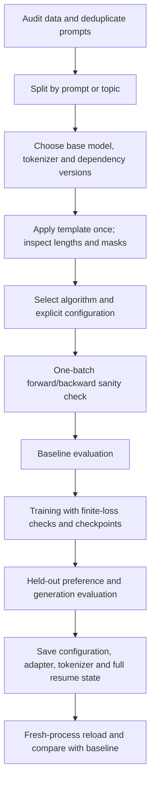

# 09 — Practical implementation guide

[Home](README.md) · [Previous: Algorithm comparison and selection](08_ALGORITHM_COMPARISON.md) · [Next: Evaluation, debugging, and best practices](10_EVALUATION_DEBUGGING_AND_BEST_PRACTICES.md)


## 1. Dependencies that actually appear

| Library/tool | Actual role in the notebooks |
|---|---|
| PyTorch | Tensors, autograd, neural models, precision and CUDA |
| Transformers/Tokenizers | Auto causal/scalar models, tokenizer/chat templates, generation |
| Datasets | JSON/external data loading, mapping, splitting and subsets |
| TRL | RewardTrainer, DPOTrainer, GRPOTrainer, experimental PPO/ORPO |
| Accelerate | Device/distributed/mixed-precision orchestration through trainers |
| PEFT | LoRA config, adapter wrapping and explicit reload |
| bitsandbytes | 4-bit NF4 model quantization and 8-bit optimizers when configured |
| Unsloth | Optimized LoRA/QLoRA and GRPO/ORPO alternative paths |
| vLLM | Fast grouped generation/LoRA inference in GRPO alternative |
| NumPy/Pandas | Seeds and DPO metric-history inspection |
| stable-baselines3/Gymnasium/Box2D/SWIG | Racing PPO demonstration and environment dependencies |
| torchao | Optional optimization package involved in recorded compatibility workarounds |
| sentencepiece | Installed tokenizer support; not explicitly used through direct import |

No training libraries were installed or model training run to produce this documentation. The source extract and external code inspection establish behavior; they do not certify a runnable current environment.

### Versions: observed outputs versus requested installs

| Notebook/path | Verifiable source evidence | What remains uncertain |
|---|---|---|
| DPO_Training | Stored PyTorch2.11.0+cu128, Transformers5.14.1, Datasets5.0.0, TRL1.8.0, PEFT.19.1 | Exact resolved full dependency tree and run provenance |
| DPO_Training_Final | Stored PyTorch2.11.0+cu128, Transformers5.14.1, Datasets5.0.1, TRL1.9.2, PEFT.20.0 | Main metrics identical to preceding notebook despite version differences |
| PPO | Stored TRL1.6.0, CUDA false; installs lower bounds | Exact remaining versions, historical loss defaults, resume semantics |
| GRPO first path | Stored TRL1.7.0 signature | Other resolved versions; second path reinstalls packages |
| ORPO standard | Requested `trl==1.9.2`; experimental imports | No printed TRL version proves resolved installation; surrounding dependencies unpinned |
| ORPO Unsloth | Requested Transformers4.56.2, TRL.22.2, Datasets4.3.0 | Unsloth/PEFT/Accelerate/bitsandbytes versions and successful execution unverified |
| Final_DPO, RL fundamentals | Unpinned installs | Resolved release versions not established |

A stored warning says `torch_dtype` is deprecated in that environment in favor of `dtype`; historical releases use `torch_dtype`. Another warning reports `warmup_ratio` deprecation. Record the environment and check signatures rather than mechanically replacing keywords across versions. Current docs and the ORPO source show experimental movement; historical API locations are not stable.

Executable inspection in a **selected training environment**:

```python
import inspect
import importlib.metadata as metadata
for package in ("torch", "transformers", "datasets", "trl", "accelerate", "peft"):
    print(package, metadata.version(package))
from trl import DPOConfig, DPOTrainer, GRPOConfig
print(inspect.signature(DPOConfig))
print(inspect.signature(DPOTrainer))
print(inspect.signature(GRPOConfig))
```

For experimental PPO/ORPO imports, use the module path confirmed in that installed release. Do not combine the two ORPO environments in one runtime. Freeze a successfully tested complete environment after the smoke check; this knowledge base does not invent a guaranteed requirements lock.

## 2. End-to-end workflow grounded in these sources

1. Parse and validate the actual local data. Keep original hashes and reject malformed rows.
2. Deduplicate/group related prompts, then create training/validation/test splits. The one-row DPO validation is pedagogical, not sufficient model selection.
3. Select a base model and exact revision. Source choices include Qwen2/Qwen2.5 .5B and SmolLM/SmolLM2 135M; their templates/vocabularies differ.
4. Load the matching tokenizer; check EOS/PAD IDs, embedding vocabulary size, precision support and chat template.
5. Build pairs for DPO/ORPO/RM or prompt metadata for PPO/GRPO. Never transfer external UltraFeedback score fields to the local JSONL by assumption.
6. Choose the objective and explicit version-compatible configuration. Verify reference behavior or reward function before constructing a long run.
7. Inspect token lengths, truncation, completion labels, attention masks and the trainer's actual collated batch.
8. Run one small forward/backward step. Check finite loss/gradients, nonzero supervised tokens and correct trainable parameters.
9. Evaluate the unmodified baseline on a fixed task suite. Save decoding settings and a disjoint preference evaluation.
10. Train with logs, periodic checkpoints and sample inspection. Stop on independent quality/regression evidence, not just loss.
11. Save adapter/model, tokenizer/template, config and full resume state when required.
12. Reload in a fresh process and compare generations with the baseline under the same sampling settings.
13. Record seed, data hash/split, model revision, environment, objective/coefficients, reward definition and measured resource use.



Reusable source: [diagram](diagrams/11_end_to_end.mmd).

## 3. Reusable data transformations using verified fields

Executable when `datasets` is installed; run from the source directory:

```python
from datasets import load_dataset
pairs = load_dataset("json", data_files="reward_preferences_dataset.jsonl", split="train")
assert set(pairs.column_names) == {"prompt", "chosen", "rejected"}

def conversational(row):
    return {
        "prompt": [{"role": "user", "content": row["prompt"]}],
        "chosen": [{"role": "assistant", "content": row["chosen"]}],
        "rejected": [{"role": "assistant", "content": row["rejected"]}],
    }
chat_pairs = pairs.map(conversational)
rollout_prompts = pairs.remove_columns(["chosen", "rejected"])

# This intentionally creates NEW metadata for the heuristic GRPO demo.
def add_demo_reference(row):
    return {"prompt": row["prompt"], "reference_answer": row["chosen"]}
demo_grpo = pairs.map(add_demo_reference, remove_columns=pairs.column_names)
```

These are transformations, not evidence that the local file was used by the active source notebooks. For RM, construct full chosen/rejected conversations including prompt context. For externally downloaded complete conversations, verify shared histories before splitting the final answer off:

```python
def split_conversation_pair(row):
    chosen, rejected = row["chosen"], row["rejected"]
    if len(chosen) < 2 or len(rejected) < 2:
        raise ValueError("Require history and final answer")
    if chosen[:-1] != rejected[:-1]:
        raise ValueError("Chosen/rejected prompt histories differ")
    if chosen[-1]["role"] != "assistant" or rejected[-1]["role"] != "assistant":
        raise ValueError("Final role must be assistant")
    return {"prompt": chosen[:-1], "chosen": [chosen[-1]], "rejected": [rejected[-1]]}
```

This check addresses an omission in ORPO's `format_preference_example`; it is meant for conversational external rows, not local plain strings.

## 4. Tokenization, boundary and mask inspection

Executable with a selected tokenizer already loaded:

```python
messages = [{"role": "user", "content": "What is AI?"}]
prompt_text = tokenizer.apply_chat_template(messages, tokenize=False, add_generation_prompt=True)
print(repr(prompt_text))
answer = "AI is the ability of machines to perform tasks that usually require human intelligence."
full_text = tokenizer.apply_chat_template(
    messages + [{"role": "assistant", "content": answer}],
    tokenize=False, add_generation_prompt=False,
)
prompt_ids = tokenizer(prompt_text, add_special_tokens=False)["input_ids"]
full_ids = tokenizer(full_text, add_special_tokens=False)["input_ids"]
print("prompt length", len(prompt_ids), "full length", len(full_ids))
print("prefix equality", full_ids[:len(prompt_ids)] == prompt_ids)
print(tokenizer.convert_ids_to_tokens(full_ids[-12:]))
```

If prefix equality fails, do not assume a loss boundary by independent string length; inspect tokenizer merges and the trainer's supported boundary logic. The compact DPO prototype has exactly this kind of warning. Some templates/versions can return assistant token masks; verify support before relying on them.

For a trainer-collated batch, print key names and shapes first. Different releases expose labels versus explicit completion masks differently. Inspect active tokens and decode the scored answer region:

```python
batch = next(iter(trainer.get_train_dataloader()))  # Trainer must already exist.
print({k: tuple(v.shape) for k, v in batch.items() if hasattr(v, "shape")})
# For a label-based causal batch, adapt prefix keys to the observed schema.
if "labels" in batch:
    labels = batch["labels"]
    valid = labels != -100
    assert valid[:, 1:].sum(1).min().item() > 0
    assert not (valid & ~batch["attention_mask"].bool()).any()
```

For DPO/ORPO keys such as chosen labels, apply the same checks to each side only after observing actual keys. Generation-oriented GRPO/PPO data loaders may initially contain prompts, so rollout masks are inspected at the trainer rollout stage instead. Do not present one loader schema as universal.

## 5. Sequence log-probability calculation

The reusable [tensor helpers](assets/tensor_patterns.py) contain this executable PyTorch pattern. It calculates standard completion-summed logps; set `average=True` for the normalized score needed by ORPO. Inputs have logits `[B,L,V]`, input IDs `[B,L]`, completion mask `[B,L]`, attention mask `[B,L]`.

```python
import torch
import torch.nn.functional as F

def completion_logps(logits, input_ids, completion_mask, attention_mask, average=False):
    if logits.shape[:2] != input_ids.shape:
        raise ValueError("Logit/input shapes disagree")
    if completion_mask.shape != input_ids.shape or attention_mask.shape != input_ids.shape:
        raise ValueError("Mask shapes disagree")
    target_ids = input_ids[:, 1:]
    if target_ids.numel() and (target_ids.min() < 0 or target_ids.max() >= logits.shape[-1]):
        raise ValueError("Token ID outside output vocabulary")
    # A target token needs an active prediction context and active target.
    valid = (completion_mask[:, 1:].bool() & attention_mask[:, 1:].bool()
             & attention_mask[:, :-1].bool())
    count = valid.sum(-1)
    if (count == 0).any():
        raise ValueError("Empty scored completion after shift/truncation")
    selected = F.log_softmax(logits[:, :-1].float(), dim=-1).gather(
        -1, target_ids.unsqueeze(-1)
    ).squeeze(-1)
    total = selected.masked_fill(~valid, 0.0).sum(-1)
    return total / count if average else total
```

This helper assumes input IDs are valid padded token IDs rather than −100 labels; full causal attention and correct position IDs are the model's responsibility. The shifted previous-attention check avoids scoring a target from a padded predecessor. Full FP32 log-softmax can be memory intensive; production trainers may use selective/fused log-softmax. A reference forward must disable gradients and reproduce the same deterministic scoring conditions.

## 6. Finite loss, seeds, metrics and checkpoints

Executable fragments with an existing model/optimizer/trainer:

```python
import random
import torch
random.seed(42)
torch.manual_seed(42)
if torch.cuda.is_available():
    torch.cuda.manual_seed_all(42)
if not torch.isfinite(loss).all():
    raise FloatingPointError("Nonfinite loss: inspect inputs, masks and reward scale")
loss.backward()
for name, param in model.named_parameters():
    if param.grad is not None and not torch.isfinite(param.grad).all():
        raise FloatingPointError(f"Nonfinite gradient: {name}")
# For FP16 GradScaler, unscale before checking/clipping gradients.
torch.nn.utils.clip_grad_norm_(model.parameters(), max_norm=1.0)
optimizer.step()
optimizer.zero_grad(set_to_none=True)
```

A norm of 1.0 is an example, not universally best. Log finite loss, gradient norm and component metrics by optimizer step. DataFrame missing values can mean an evaluation event lacks training columns, as in the DPO source history; inspect event dictionaries before diagnosing NaNs.

Saving example with all generated experiment outputs kept under this knowledge base:

```python
from pathlib import Path
run_dir = Path("RLHF_COMPLETE_NOTES/assets/experiments/my_run")
run_dir.mkdir(parents=True, exist_ok=True)
trainer.save_model(str(run_dir))
tokenizer.save_pretrained(str(run_dir))
trainer.save_state()
# Verify that args.output_dir also points under run_dir before training.
# When supported and a FULL checkpoint exists:
# trainer.train(resume_from_checkpoint=str(run_dir / "checkpoint-20"))
```

`save_state()` alone is not a complete optimizer checkpoint; periodic Trainer checkpoints should retain optimizer/scheduler/RNG when resume is needed. Checkpoint names and resume support differ for experimental/custom trainers. A LoRA adapter must reload with its correct base revision and tokenizer; optimizer state is irrelevant for inference but essential for faithful resume.

Seed reproducibility is conditional on versions, data order, distributed operations and sampling kernels. Record all of them. Training loss curves without data/config provenance are insufficient experiment records.

## 7. Resource planning with stated assumptions

Let P be parameter count and b bytes per parameter. Weight storage is approximately P×b, excluding quantization metadata and runtime overhead. A 0.5B model's 16-bit weights are roughly 1GB in decimal units; 135M gives roughly .27GB. Nominal 4-bit storage is P×.5 bytes plus scale/metadata; loading, activations and adapters make total VRAM substantially larger.

For a full-parameter Adam mixed-precision setup, an illustrative accounting is 2 bytes low-precision weights + 2 bytes gradients + 4 bytes master weights + 8 bytes FP32 moments≈16 bytes per trainable parameter, or about8GB for .5B **before activations**. Optimizer implementations and distributed sharding change this. LoRA largely reduces trainable gradient/moment storage, but the base weights and forward activations remain.

| Choice | Main impact |
|---|---|
| Longer sequences | More activations/KV cache; naive attention can scale quadratically, memory-efficient attention alters materialization |
| Larger microbatch | More simultaneous pair/rollout activations |
| Gradient accumulation | Larger effective batch with lower microbatch peak; still changes step/noise dynamics |
| DPO separate reference | Extra weights and no-grad forward; sharing/caching can reduce this |
| PPO critic | Trainable critic weights, gradients, optimizer and activations |
| GRPO group G | More generated tokens/cache and scorer work per unique prompt |
| Mixed precision | Reduces many tensors; some reductions/log-odds/optimizer states stay FP32 |
| Checkpointing | Lower activation memory at extra forward recomputation |
| LoRA/QLoRA | Lower optimizer/trainable storage; pair/rollout activation cost remains |
| Longer generation | More sequential rollout compute and KV cache; may hide final answer via truncation |

Measure actual peak allocation and wall time on a small pilot. Compare **unique prompts**, generated responses, scored tokens and optimizer steps separately. GRPO batch4 with G4 can represent fewer unique prompts than four; do not equate candidate count with prompt count. `device_map="auto"` can dispatch model weights but does not by itself make a distributed training configuration correct.

## Revision

Use actual schema and actual trainer version; inspect masks before updates; measure finite losses, independent evaluation and resource use; save/reload the correct adapter/base/tokenizer. The source notebooks provide patterns and pitfalls, not a version-independent training recipe.
