# Diagram and plot library

Original educational diagrams. Mermaid sources can be reused in supported Markdown renderers; no external image attribution is needed. Analytical plots show illustrative objective behavior, not measured training results.

## 01 classical rlhf

[Reusable source](01_classical_rlhf.mmd)

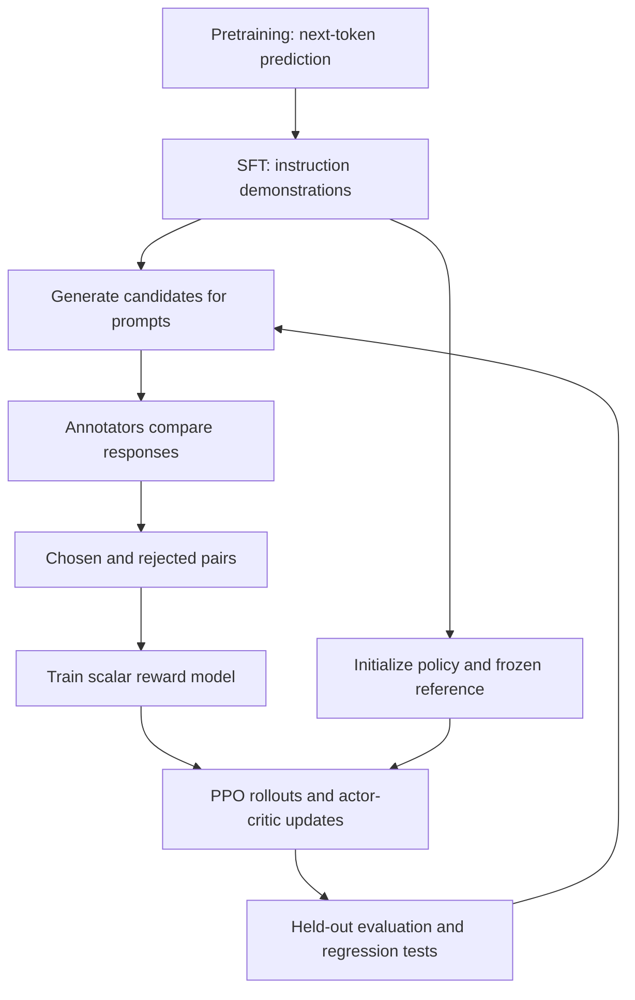

## 02 model roles

[Reusable source](02_model_roles.mmd)

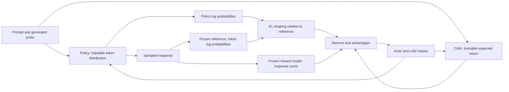

## 03 ppo loop

[Reusable source](03_ppo_loop.mmd)

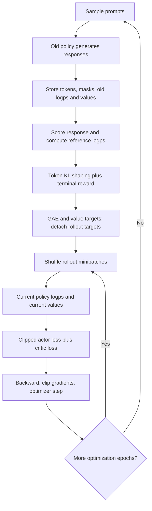

## 04 ppo clipping

[Reusable source](04_ppo_clipping.mmd)

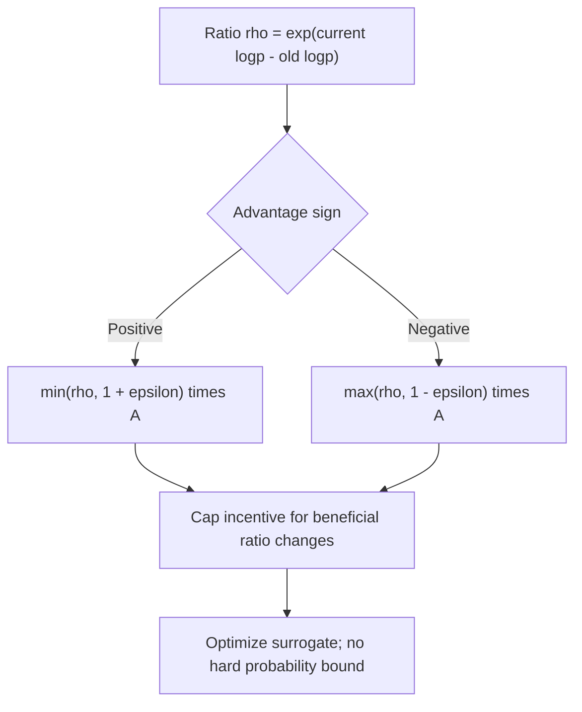

## 05 dpo pipeline

[Reusable source](05_dpo_pipeline.mmd)

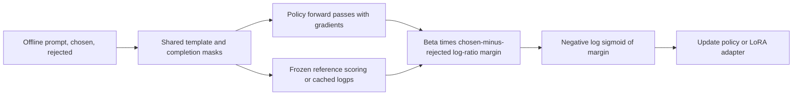

## 06 dpo logps

[Reusable source](06_dpo_logps.mmd)

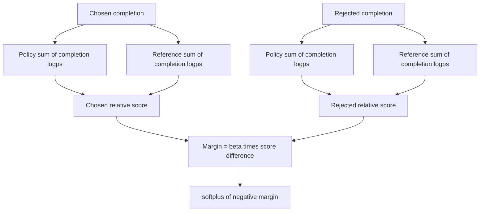

## 07 grpo groups

[Reusable source](07_grpo_groups.mmd)

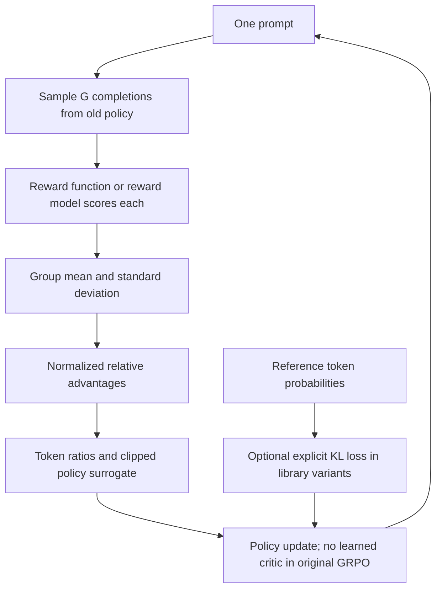

## 08 orpo objective

[Reusable source](08_orpo_objective.mmd)

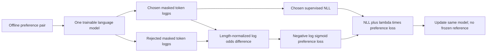

## 09 all data flows

[Reusable source](09_all_data_flows.mmd)

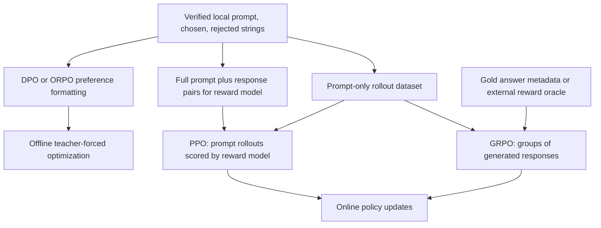

## 10 selection tree

[Reusable source](10_selection_tree.mmd)

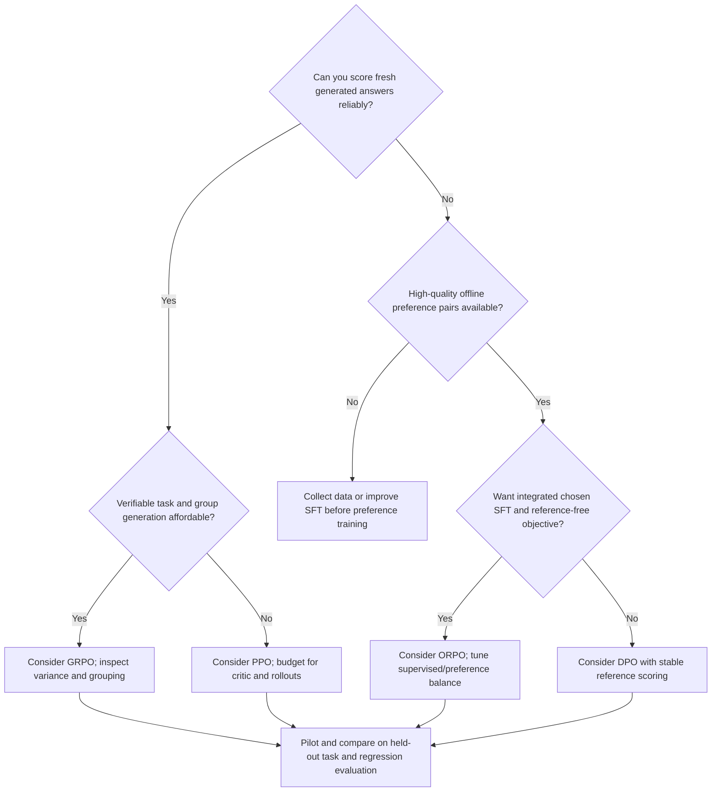

## 11 end to end

[Reusable source](11_end_to_end.mmd)

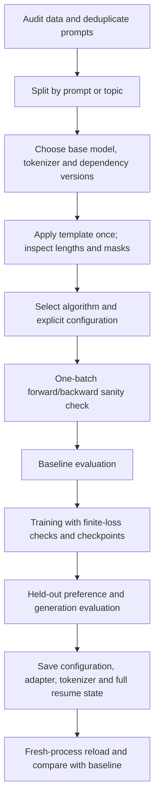

## 12 rl to llm

[Reusable source](12_rl_to_llm.mmd)

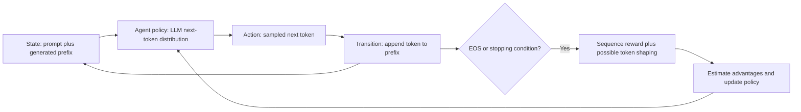

## 13 reward pair

[Reusable source](13_reward_pair.mmd)

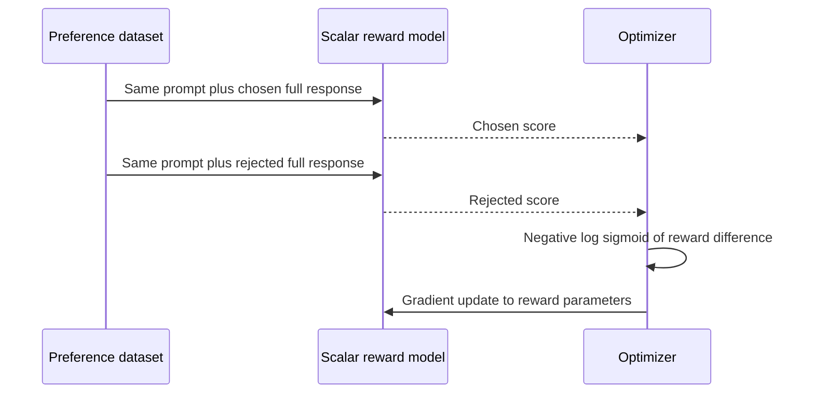

## Reproducible analytical plots

For fixed advantages +1 and −1, clipping width0.2; current/old ratios vary independently. These curves are surrogate incentives, not hard constraints.

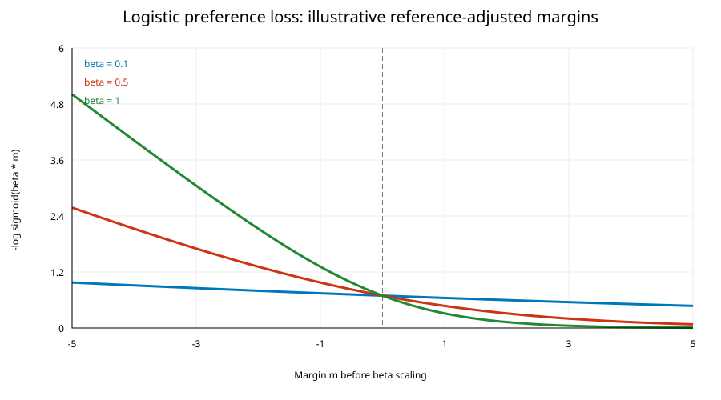

−logσ(βm) against illustrative reference-adjusted log-probability margin m, for β0.1/0.5/1. No training data used. [Generator](../assets/plot_objectives.py).
